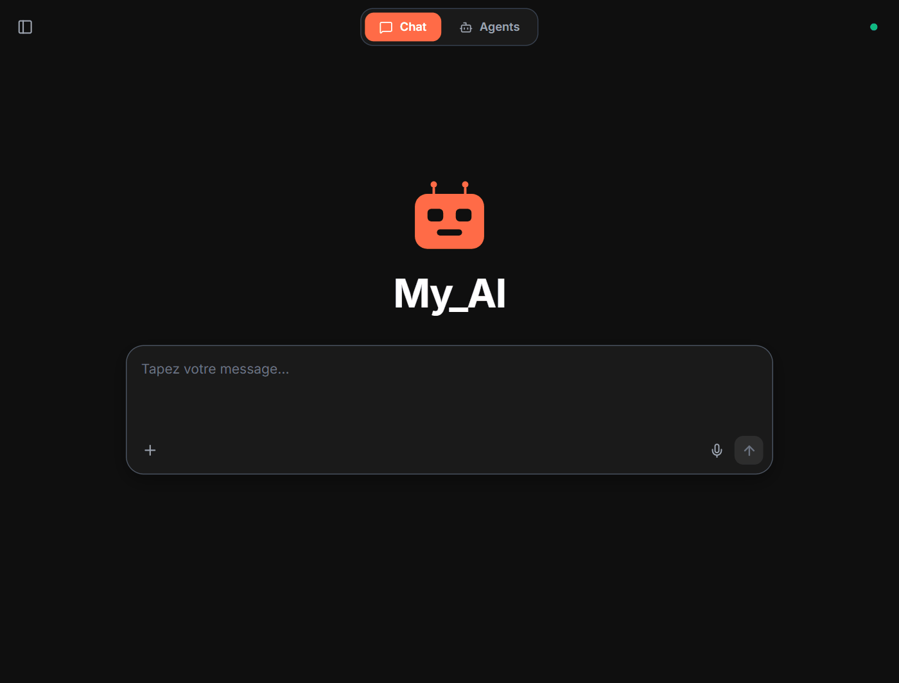
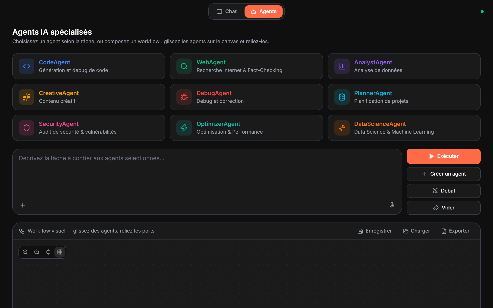
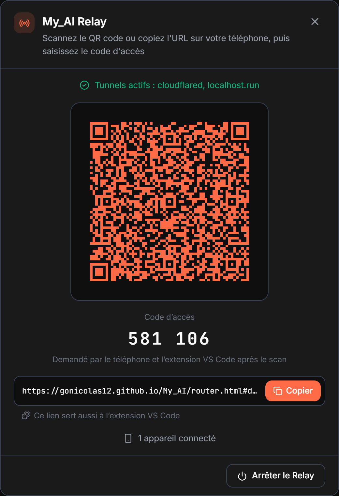
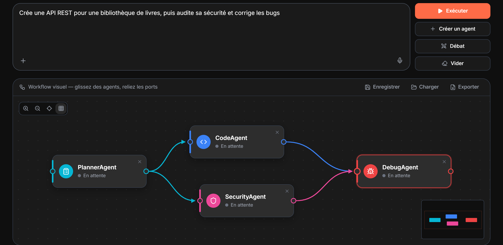

<div align="center">


# My_AI

### Une IA personnelle, confidentielle et locale

Chat, agents, documents, images et voix, propulsés par [Ollama](https://ollama.com).<br>
En 12 langues. Vos conversations, vos fichiers et votre mémoire restent sur votre machine.

[](https://github.com/gonicolas12/My_AI/stargazers)
[](https://github.com/gonicolas12/My_AI/releases)
[](https://www.python.org/)
[](https://ollama.com/download)
[](#-démarrage-rapide)
[](LICENSE)

[English](README.md) · **Français**

[🚀 Démarrage rapide](#-démarrage-rapide) · [⚡ Fonctionnalités](#-fonctionnalités) · [🤖 Agents](#-agents-ia) · [📡 Accès mobile](#-my_ai-relay--accès-mobile) · [🧩 Extension VS Code](#-extension-vs-code) · [📖 Documentation](#-documentation)



</div>

## ✨ Pourquoi My_AI ?

- 🔒 **Confidentielle par conception.** Le modèle tourne sur votre PC via Ollama. Conversations, documents et mémoire restent en local (ChromaDB + SQLite). Une fois les modèles téléchargés, tout fonctionne hors ligne, sauf la recherche web et l'accès mobile.
- 🧩 **Tout dans une seule fenêtre.** Chat avec réflexion et recherche web sourcée, 9 agents spécialisés et un éditeur de workflows visuel, génération Word, PDF, Excel et PowerPoint, génération d'images locale, voix en entrée et en sortie, tâches planifiées.
- 📱 **Là où vous travaillez.** Parlez à l'IA de votre PC depuis votre téléphone, via un relais chiffré de bout en bout, ou laissez-la lire et modifier votre projet depuis VS Code.
- 🌍 **12 langues.** L'interface, les réponses, la voix et les documents générés suivent votre langue : anglais, français, espagnol, allemand, italien, portugais, néerlandais, russe, chinois, japonais, coréen et arabe (de droite à gauche).
- 🪶 **Pensée pour des machines modestes.** Au premier lancement, l'assistant détecte votre RAM et votre GPU, puis télécharge le modèle adapté (de 2 à 9 milliards de paramètres). My_AI mesure si votre GPU intégré va plus vite et garde le plus rapide.

## 🖥️ Captures d'écran

<table>
<tr>
<td width="57%"></td>
<td rowspan="2"></td>
</tr>
<tr>
<td></td>
</tr>
<tr>
<td align="center"><b>Agents et workflows visuels</b></td>
<td align="center"><b>Accès mobile avec le Relay</b></td>
</tr>
</table>

## 🚀 Démarrage rapide

**Prérequis :** Python 3.10+ et [Ollama](https://ollama.com/download).

```bash
git clone https://github.com/gonicolas12/My_AI
cd My_AI
pip install -r requirements.txt
```

Lancez ensuite l'application et choisissez **l'option 1 (Interface Graphique)** :

```bash
.\launch.bat      # Windows
./launch.sh       # macOS / Linux
```

Au **tout premier lancement**, My_AI s'affiche dans la langue de Windows (l'une des 12, l'anglais sinon, changeable dès l'assistant), détecte votre matériel (RAM, cœurs CPU, VRAM GPU), **recommande et télécharge** le modèle adapté, puis crée `my_ai` automatiquement. La fenêtre s'ouvre tout de suite sur un écran de chargement qui nomme chaque étape (Ollama, modèle, placement, moteur), puis passe au Chat.

> ⚠️ **Mac Intel (x86_64) : Python 3.12 maximum.** PyTorch ne publie plus de build x86_64 au-delà de la version 2.2.2, dont les wheels s'arrêtent à Python 3.12. Sous Python 3.13+, l'installation échoue. `launch.sh` vérifie ce point au démarrage. Apple Silicon, Windows et Linux ne sont pas concernés.

> 💡 Sans passer par un lanceur, `python launch_unified.py` (fenêtre + configuration d'Ollama) et `python main.py --mode gui` (fenêtre seule, avec l'Ollama déjà lancé) fonctionnent sur les trois systèmes. Sous Linux, la fenêtre demande GTK ou Qt (`pip install "pywebview[qt]"`) ; sans eux, l'interface s'ouvre dans le navigateur.

<details>
<summary><b>Installation manuelle des modèles</b></summary>

```bash
# Modèle (choisir selon votre RAM) : il lit le texte et les images
ollama pull qwen3.5:2b       # Ultra léger — réponses concises (4 GB RAM)
ollama pull qwen3.5:4b       # Recommandé — léger et rapide (8 GB RAM)
ollama pull qwen3.5:9b       # Plus lourd — réponses détaillées (16 GB RAM)

# Créer le modèle personnalisé
.\create_custom_model.bat
```

- 🖼️ **Images** : qwen3.5 les voit, donc `my_ai` répond lui-même aux questions sur une image, sans second modèle à télécharger ni à garder en mémoire. Un modèle vision dédié (`ollama pull minicpm-v`, `llava`...) ne prend le relais que si le `Modelfile` part d'un modèle qui ne voit pas les images.
- 🔄 **`Modelfile` modifié ?** (à la main, par un `git pull` ou par ⚙️ Réglages) : `my_ai` est **recréé automatiquement au lancement suivant**, inutile de relancer `create_custom_model.bat`. Le lancement ne fait rien de plus tant que le `Modelfile` ne change pas.
- **Changer de modèle** : le plus simple est le **panneau Réglages** (en bas de la barre latérale, ou Ctrl+virgule) → *Modèles Ollama* → choisir le modèle → *Appliquer* (régénère `my_ai` automatiquement, system prompt préservé). Manuellement : modifiez `llm.local.default_model` dans `config.yaml` **et** la ligne `FROM` du `Modelfile`, puis relancez My_AI : `my_ai` est recréé au lancement.

</details>

<details>
<summary><b>🎮 Monitoring GPU (optionnel)</b></summary>

Le suivi GPU dans l'onglet Agents nécessite des packages supplémentaires **selon votre carte graphique** :

```bash
# NVIDIA (nécessite les drivers NVIDIA installés)
pip install pynvml GPUtil

# AMD (nécessite ROCm ou les drivers AMDGPU + Microsoft C++ Build Tools)
pip install pyamdgpuinfo

# Windows — tout GPU (infos basiques : nom, VRAM totale)
pip install wmi
```

**Sans ces packages**, l'application fonctionne normalement : les métriques GPU affichent simplement « N/A ».

</details>

<details>
<summary><b>🌐 Réseaux avec proxy (optionnel)</b></summary>

Le projet supporte les proxys standards via variables d'environnement **et** via `config.yaml` (section `network`).

Exemples (PowerShell) :

```powershell
$env:HTTP_PROXY="http://proxy.company.com:8080"
$env:HTTPS_PROXY="http://proxy.company.com:8080"
$env:NO_PROXY="localhost,127.0.0.1,::1"
```

Exemples (Linux/macOS) :

```bash
export HTTP_PROXY="http://proxy.company.com:8080"
export HTTPS_PROXY="http://proxy.company.com:8080"
export NO_PROXY="localhost,127.0.0.1,::1"
```

Si votre proxy intercepte TLS, renseignez aussi `network.ca_bundle` dans `config.yaml` avec le chemin de votre certificat racine (PEM). Le mode `network.allow_insecure_ssl: true` existe en dernier recours, mais il est déconseillé en production.

</details>

<details>
<summary><b>🧹 Nettoyage en cas de problème</b></summary>

```bash
.\clean_project.bat
```

Si vous observez des comportements inattendus ou des erreurs après plusieurs lancements, ce script supprime tous les fichiers temporaires (logs, caches, historiques) pour repartir sur une base propre.

</details>

## ⚡ Fonctionnalités

### 💬 Chat

| Fonctionnalité | Détail |
|---|---|
| 🧠 **Mode Thinking** | Pour les requêtes complexes, l'IA réfléchit étape par étape avant de répondre : bloc « Réflexion » repliable, texte animé pendant la génération |
| 🔍 **Recherche Internet** | Informations en temps réel via DuckDuckGo (Yahoo et Wikipédia en secours), sources numérotées `[n]` cliquables |
| 🎨 **Aperçu Artifacts** | Volet de rendu live HTML/CSS/SVG et des documents générés |
| ⚡ **Slash commands** | Tapez `/` en début de saisie : autocomplétion de prompts réutilisables (`/code`, `/résume`, `/traduis`…), expansés à l'envoi en un prompt détaillé, la bulle gardant la commande courte |
| 🎹 **Palette de commandes** | Ctrl+K : toutes les actions de l'appli au clavier |
| 🧭 **Barre latérale** | Conversations, recherche sémantique globale sur toutes les conversations, dossiers du projet, historique |
| 💼 **Multi-workspaces** | Sessions isolées avec sauvegarde automatique, export Markdown, HTML et PDF dans toutes les langues |
| 🎓 **Feedback RLHF** | Notation 1-5 étoiles sous chaque réponse, apprentissage automatique depuis vos retours |

### 🤖 Agents IA

| Agent | Rôle |
|---|---|
| 🐍 **CodeAgent** | Génération et debug de code multi-langages |
| 🔍 **WebAgent** | Recherche Internet & Fact-Checking |
| 📊 **AnalystAgent** | Analyse de données et insights |
| ✨ **CreativeAgent** | Rédaction et contenu créatif |
| 🐛 **DebugAgent** | Détection et correction d'erreurs |
| 📋 **PlannerAgent** | Planification de projets complexes |
| 🛡️ **SecurityAgent** | Audit de sécurité & vulnérabilités |
| ⚡ **OptimizerAgent** | Optimisation & Performance |
| 🧬 **DataScienceAgent** | Data Science & Machine Learning |

- 🧩 **Agents personnalisés** : décrivez l'agent voulu, son prompt système est rédigé par le modèle local.
- 🔄 **Canvas de workflow visuel** (style n8n) : nœuds connectables, zoom/pan, grille, minimap ; exécution séquentielle, parallèle ou en DAG.
- 🧵 **Fils d'exécution** : chaque exécution est un fil rouvrable.
- 🎭 **Mode Débat** : confrontation argumentée entre deux agents.
- 📊 **Statistiques et monitoring ressources** : CPU, RAM, GPU, VRAM, temps d'inférence et tokens/s.
- 📅 **Tâches planifiées** : exécution **récurrente** d'un agent, d'un workflow ou d'un débat, *quotidienne*, *hebdomadaire*, à *intervalle* ou en **cron** (ex. « chaque matin 8h, WebAgent sur l'actu IA et résume »). Exécution même l'application fermée (option) via le **Planificateur de tâches Windows**, sans droits admin ni mot de passe stocké. Rattrapage des tâches manquées au redémarrage, notifications (toast OS + entrée GUI + message mobile), rapports `.md` dans `outputs/scheduled/`.
- 🔔 **Notifications desktop** à la fin d'une tâche longue.

### 📝 Documents

- **Documents bureautiques** : « *génère moi un docx sur les baleines* », « *fais-moi un PDF de synthèse* », « *crée une présentation PowerPoint…* », « *un tableur Excel comparant…* ». Le modèle local rédige, python-docx, reportlab, python-pptx et openpyxl mettent en forme : titres, listes imbriquées, tableaux stylés, sommaire Word, découpe automatique des diapos, onglets Excel avec filtre.
- **Dans la langue du document** : mentions « Généré le », sommaire, numéros de page et noms de feuilles suivent la langue du texte. Le PDF prend la police qu'il faut (chinois, japonais, coréen, cyrillique, arabe).
- **Modification des pièces jointes** (docx, xlsx, pptx, md, pdf…) : remplacer un texte, réécrire une section, ajouter une ligne ou une diapo. **Le fichier d'origine n'est jamais touché** : la copie modifiée est écrite dans `outputs/documents/`.
- **Aperçu au format natif** dans le volet latéral, ouvert automatiquement : visionneuses Word, PowerPoint et Excel de l'Explorateur Windows, lecteur PDF d'Edge. Rendu HTML de repli ailleurs, et sur le mobile Relay.
- **Lecture de fichiers** : PDF (avec OCR des pages scannées), DOCX, PowerPoint, Excel, CSV et code, avec un découpage intelligent des très longs documents.

### 🎨 Génération d'images locale (texte → image)

- **Symétrie multimodale** : l'IA *voit* (vision Ollama) **et** *dessine*. Demandez « *génère une image de…* », « *dessine-moi…* », « *crée un logo…* ».
- **Installation automatique (zéro config)** : à la première demande sans backend, My_AI télécharge et lance **ComfyUI portable** tout seul (Windows : build NVIDIA, AMD ou Intel Arc selon le GPU, sinon sur le CPU ; Python+torch embarqués) + un modèle par défaut, comme l'assistant de premier lancement pour Ollama.
- **100% local** via un backend **Stable Diffusion** en HTTP : **ComfyUI** (auto-installé), **AUTOMATIC1111 / Forge**, ou **diffusers** (optionnel, tous GPU + CPU), configurable dans `config.yaml` → `image_generation:`.

### 🎙️ Voix

- **Bouton micro** dans chaque zone de saisie (accueil, conversation, onglet Agents) : 1er clic démarre l'écoute, 2ème clic stoppe et lance la transcription, insérée au curseur de la zone active.
- **100% local** via [faster-whisper](https://github.com/SYSTRAN/faster-whisper) : modèle `small` (~150 Mo) chargé à la demande, **langue auto-détectée** (99+ langues supportées par Whisper).
- **Lecture vocale** : bouton sous chaque réponse et mode lecture auto, avec une voix par langue.

### 🧠 Une mémoire sous votre contrôle

- **Mémoire vectorielle jusqu'à 10 485 760 tokens** (ChromaDB + SQLite), recherche sémantique (sentence-transformers + HNSW cosinus), chunking intelligent avec chevauchement (chunk 256 tokens, overlap 32), résumé glissant automatique à la moitié de la fenêtre de contexte (16k tokens sur 32k).
- **« Retiens que… »** dans le chat : le fait est vraiment enregistré (onglet Faits du panneau Mémoire), et les faits utiles accompagnent ensuite chaque réponse.
- Un panneau **Mémoire** pour **voir, éditer et supprimer** ce que l'IA sait de vous, avec de **vraies** opérations CRUD, 100% local. **3 onglets** : **Faits** (SQLite), **Documents** et **Conversations** (vecteurs ChromaDB), avec recherche, filtre par catégorie, pagination et provenance (quelle session, quel document).
- La suppression d'une entrée vectorielle est une **vraie suppression dans ChromaDB** (`collection.delete`). Pour les conversations, l'option **« supprimer à la source »** retire durablement le message d'origine du workspace.

### 📁 Contexte projet « @codebase » (RAG persistant)

- **Attachez un dossier entier** (codebase ou dossier de docs) à un workspace : l'IA garde ce contexte **disponible en permanence** pour toutes les questions, plus besoin de re-glisser les fichiers.
- **Indexation incrémentale 100% local** : réutilise la mémoire vectorielle (collection `codebase`) et les processeurs existants ; **respecte `.gitignore`** et exclut `node_modules`, `.git`, `.venv`, `dist`… Seuls les fichiers modifiés sont retraités au réindex.
- **Récupération au moment de la question** (RAG) + **court-circuit déterministe** pour les questions *sur* le dossier (chemin, liste de fichiers).
- **Fenêtre** : section « Dossiers du projet » de la barre latérale. **VS Code** : menu **`@`** pour attacher fichiers/dossiers, un seul contexte `@codebase` par projet.

### 🔌 MCP et accès à tout le PC

- **Intégration MCP (Model Context Protocol)** : connexion standardisée à des outils locaux et serveurs externes (fichiers, git, bases de données).
- Outils locaux pour **lire, écrire, déplacer des fichiers** et **créer des dossiers**, avec vérification des **chemins complets** retournés par les outils : l'IA peut **organiser les espaces de travail** de manière autonome.
- Dialogue de **confirmation** avant toute **suppression de fichier**.

### 🦙 Intégration Ollama — LLM 100% local

- **Multi-modèles** : `qwen3.5:2b`, `qwen3.5:4b`, `qwen3.5:9b` (texte **et** images), `mistral`... ; un modèle vision dédié (`minicpm-v`, `llava`, `llama3.2-vision`...) ne prend les images que si le modèle choisi ne les voit pas.
- **Placement automatique** : au lancement, My_AI regarde où Ollama place le modèle. Resté sur le processeur, il mesure si le GPU intégré va plus vite et garde le plus rapide ; quand le modèle déborde de la carte graphique (ou du GPU intégré), son contexte passe en 8 bits s'il va plus vite. Le choix est gardé, et remesuré après une mise à jour d'Ollama ou un changement de matériel.
- **Une seule fenêtre de contexte** (32 768 tokens, 65 536 en option) pour tous les appels : Ollama ne recharge plus le modèle d'une étape à l'autre et reprend la conversation déjà lue.
- **Modèle personnalisable** : température, contexte, system prompt via le `Modelfile`.
- **Fallback intelligent** : sans Ollama, l'IA bascule automatiquement en mode patterns/règles.

### 🌐 Et aussi

- 🌐 **API REST** : serveur FastAPI intégré pour les intégrations externes.
- 🎓 **RLHF, pipeline d'entraînement et compression** : apprentissage depuis le feedback, fine-tuning avec monitoring, ratios de compression détaillés ([fonctionnalités avancées](docs/ADVANCED_FEATURES.md)).
- 💻 **Multiplateforme** : Windows · macOS · Linux.

## 📡 My_AI Relay — accès mobile

Parlez à votre IA depuis votre téléphone (iOS/Android), où que vous soyez, tant que l'application tourne sur votre PC.

### Fonctionnement

1. Cliquez sur **Relay** en bas de la barre latérale (ou Ctrl+R)
2. My_AI Relay démarre un serveur WebSocket et ouvre des tunnels sécurisés en parallèle (cloudflared et localhost.run)
3. Scannez le QR code ou copiez l'URL sur votre téléphone, puis saisissez le **code d'accès** affiché sous le QR code
4. L'interface mobile propose deux onglets en haut, **💬 Chat** et **🤖 Agents** (comme le GUI PC) :
   - **Chat** : discutez en temps réel ; les messages apparaissent aussi sur le PC. Le bouton d'envoi devient un **bouton Stop** pendant la génération, et les liens `[titre](url)` s'affichent en bleu cliquable.
   - **Agents** : toute la page Agents du PC en version tactile : grille d'agents, **création/édition/suppression d'agents personnalisés**, **workflow visuel n8n** (glisser des nœuds, relier les ports), **Mode Débat** et exécution streamée.
5. Joignez images, PDF, DOCX, PowerPoint, Excel ou fichiers de code via le bouton **+** (sur le Chat **et** sur la page Agents) : ils sont traités par les mêmes processeurs que le PC (modèle vision pour les images, contexte vectoriel pour les documents)
6. Demandez un document (« *génère un pdf sur…* ») : son aperçu s'ouvre automatiquement dans la modale, avec un bouton 💾 pour télécharger le fichier

### Caractéristiques

| Fonctionnalité | Détail |
|---|---|
| 📱 **Interface mobile** | PWA responsive, thème sombre, onglets Chat / Agents |
| 🤖 **Page Agents** | 9 agents spécialisés + agents personnalisés, workflow visuel (séquentiel / parallèle / DAG), Mode Débat, exécutés côté PC (Ollama local), streamés au mobile |
| 🔒 **Authentification** | Jeton aléatoire dans le lien du QR code, nouveau à chaque démarrage, plus un **code d'accès** à 6 chiffres affiché sous le QR code mais absent du lien : un lien qui fuite ne suffit pas (5 essais, puis Relay verrouillé jusqu'à son redémarrage) |
| 🛡️ **Chiffrement E2EE** | AES-256-GCM applicatif au-dessus du tunnel : ni les services de tunnel (Cloudflare, localhost.run), ni GitHub Pages ne peuvent lire le contenu (clé éphémère partagée par QR code) |
| 🌐 **Multi-tunnel** | cloudflared + localhost.run en parallèle (serveo en option), chacun vérifié depuis le PC : seuls les joignables entrent dans le QR code ; failover côté client |
| 🔄 **Synchronisation** | Messages du chat visibles en temps réel sur PC et mobile |
| ⚡ **WebSocket** | Communication instantanée, streaming, indicateur de frappe, bouton Stop |
| 📎 **Pièces jointes** | Chat + Agents : images + documents (PDF, DOCX, PPTX, XLSX, CSV, code) jusqu'à 25 Mo, chiffrés bout-en-bout, routés vers vision + contexte |
| 📥 **Auto-install** | cloudflared est téléchargé automatiquement si absent |

### Configuration (`config.yaml`)

```yaml
relay:
  auto_start: false      # Démarrage auto au lancement du GUI
  port: 8765             # Port du serveur Relay
  response_timeout: 500  # Délai max de réponse IA (secondes)
  tunnel: true           # Activer les tunnels (tunnel_providers)
  tunnel_providers: ["cloudflared", "localhost.run"]  # "serveo" en option, voir docs/USAGE.md
  host: "0.0.0.0"        # Adresse d'écoute
```

> **Sans tunnel** (`tunnel: false`, ou aucun fournisseur joignable), le Relay reste accessible sur le réseau local uniquement.

## 🧩 Extension VS Code

**My_AI Relay** est aussi disponible comme extension sur le [**Marketplace VS Code**](https://marketplace.visualstudio.com/items?itemName=gonicolas12.my-ai). Elle ne se contente pas de relayer le chat : elle expose un **mode agentique** où le LLM local (sur le PC hôte) peut lire, modifier, créer des fichiers, lancer des commandes shell et chercher dans votre workspace VS Code, chaque action visible et approuvable dans le chat.

### Fonctionnement

1. Sur le PC hôte : démarrez le Relay (**Relay** en bas de la barre latérale, ou Ctrl+R) → dès qu'un tunnel répond, cliquez sur **Copier** dans le panneau : la chaîne de connexion est le lien du QR code
2. Dans VS Code : installez l'extension **My_AI Relay** depuis le Marketplace → ouvrez la vue dans la sidebar → **Coller la chaîne de connexion** → saisissez le **code d'accès** affiché sous le QR code
3. À la connexion, l'extension s'identifie comme client `vscode` auprès du Relay et active le mode agentique. Demandez par exemple *« scaffold un projet Vite + React avec un router et un composant Header »* : vous verrez chaque `write_file` / `run_command` apparaître comme une carte dépliable dans le chat, avec demande d'approbation pour les opérations destructives.

> **Une conversation Code, trois endroits.** La conversation de VS Code s'affiche aussi sur la page **Code** de l'application desktop (bouton **Code** en haut de la barre latérale) et dans la vue **Code** du téléphone (bouton `</>` à gauche de **Chat**) : un message tapé là part à l'extension, qui agit dans son workspace, et la réponse arrive en streaming partout. Sur la page du PC, un message peut porter les pièces jointes du chat (documents, code, images décrites par le modèle vision) et se dicter avec la saisie vocale locale. Une écriture ou une commande shell demandée depuis le PC ou le téléphone attend une approbation, donnée depuis n'importe lequel des trois. Le chat classique (téléphone + desktop) reste séparé : rien de lui n'arrive dans VS Code, et inversement. Il garde le pipeline classique avec les MCP locaux complets : le mode agentique est réservé à la conversation Code.

### Caractéristiques

| Fonctionnalité | Détail |
|---|---|
| 🤖 **Mode agentique** | 9 outils exposés au LLM (`read_file`, `write_file`, `edit_file`, `list_dir`, `glob`, `grep`, `run_command`, `get_active_editor`, `open_file`) avec boucle de raisonnement multi-étapes |
| 📎 **Menu `@`** | Taper `@` attache un fichier au message, ou un **dossier** comme contexte **@codebase** persistant (indexé côté hôte, un seul contexte par projet) |
| ⚡ **Slash commands** | Autocomplétion `/` des prompts My_AI, expansés en prompt détaillé à l'envoi (la bulle garde la commande courte) |
| ⏹️ **Bouton STOP** | Interrompt en un clic toute la génération du tour : LLM **et** boucle d'outils agentique (appels en attente compris). **Clear** (« Effacer ») pendant une génération l'arrête aussi |
| 🛟 **Garde-fou anti-boucle** | Détection des réécritures répétées du même fichier pour éviter qu'un agent ne tourne en rond |
| 🛡️ **Sandbox workspace** | Tous les chemins sont résolus à partir du workspace VS Code ouvert. Toute sortie hors workspace nécessite une approbation modale par chemin |
| ✋ **Approbations granulaires** | Lectures auto-approuvées, écritures/commandes shell sous modal avec options *Une fois* / *Pour ce fichier* / *Tout autoriser pour cet outil cette session* ; pour un message tapé sur le PC ou le téléphone, les mêmes choix en boutons dans la carte de l'outil, dans VS Code, sur le PC et sur le téléphone |
| 🎴 **Cartes d'outils inline** | Chaque appel d'outil rendu comme carte pliable (orange = en cours · indigo = en attente d'approbation · vert = OK · rouge = erreur · gris = refusé) |
| 🧠 **Mémoire partagée** | Une seule conversation pour VS Code, la page **Code** du desktop et le téléphone, gardée d'une reconnexion et d'un redémarrage à l'autre (« édite le fichier que tu viens de lire » fonctionne) ; **Effacer** en commence une nouvelle partout |
| 🔧 **Marche avec n'importe quel modèle Ollama** | Format `<tool_use>{...}</tool_use>` parsé côté hôte, pas besoin de l'API tools native d'Ollama |
| 🔐 **Chiffrement E2EE** | AES-256-GCM identique au mobile : le tunnel ne voit que du ciphertext |
| 🌐 **Failover multi-tunnel** | cloudflared / localhost.run (serveo en option) pingés côté client, bascule auto |
| 💾 **Persistance** | Identifiants chiffrés dans le SecretStorage de VS Code (keychain OS) |
| 🔄 **Auto-reconnexion** | Détection arrêt du Relay hôte, reconnexion auto au redémarrage |
| 🌍 **12 langues** | L'extension parle la langue de My_AI (choisie dans ses Réglages), comme l'application desktop et le téléphone ; les titres des commandes suivent la langue de VS Code |
| 🆓 **Open source** | Code dans [`vscode_extension/`](vscode_extension/), licence MIT |

### Installation

```
# Depuis VS Code : Extensions (Ctrl+Shift+X) → recherche "My_AI Relay" → Install
# OU en ligne de commande :
code --install-extension gonicolas12.my-ai
```

> Voir [`vscode_extension/README.md`](vscode_extension/README.md) (anglais) ou [`vscode_extension/README.fr.md`](vscode_extension/README.fr.md) (français) pour la doc complète, la liste exhaustive des outils et les détails du flux d'approbation.

## 📖 Documentation

| Document | Description |
|---|---|
| [🏗️ Architecture](docs/ARCHITECTURE.md) | Structure technique détaillée, arborescence complète |
| [📦 Installation](docs/INSTALLATION.md) | Guide d'installation complet |
| [🔍 Recherche Internet](docs/INTERNET_SEARCH.md) | Guide complet sur la recherche web |
| [⚡ Optimisation](docs/OPTIMIZATION.md) | Conseils et techniques d'optimisation locale |
| [💾 Mémoire Vectorielle 10M](docs/ULTRA_10M_TOKENS.md) | Détails sur la gestion de la mémoire interne étendue |
| [🧠 Mémoire (contrôle)](docs/MEMORY.md) | Voir / éditer / supprimer ce que l'IA sait (faits + vecteurs) |
| [🔎 Recherche globale](docs/CONVERSATION_SEARCH.md) | Recherche sémantique sur toutes les conversations |
| [⚡ Bibliothèque de prompts](docs/PROMPT_LIBRARY.md) | Slash commands |
| [📁 Contexte @codebase](docs/CODEBASE.md) | Attacher un dossier projet entier en RAG persistant |
| [📋 Usage](docs/USAGE.md) | Exemples d'utilisation et workflows |
| [📝 Changelog](docs/CHANGELOG.md) | Historique des mises à jour |
| [❓ FAQ](docs/FAQ.md) | Questions fréquentes et réponses détaillées |
| [📄 Génération de Fichiers](docs/FILE_GENERATION.md) | Guide sur la génération de fichiers via l'IA |
| [📄 Génération de Documents](docs/DOCUMENT_GENERATION.md) | Word/PDF/PowerPoint/Excel : création, modification, aperçu |
| [🎨 Génération d'Images](docs/IMAGE_GENERATION.md) | Texte → image 100% local (backends, auto-install, GPU) |
| [🤖 Agents IA](docs/AGENTS.md) | Documentation complète sur les agents spécialisés |
| [🎨 Agents GUI](docs/AGENTS_GUI.md) | Guide de l'interface graphique agents |
| [🎨 Aperçu Artifacts](docs/ARTIFACTS_PREVIEW.md) | Volet de rendu live HTML/CSS/SVG et documents |
| [📅 Tâches planifiées](docs/SCHEDULER.md) | Scheduler proactif : agents/workflows récurrents (cron) |
| [🔌 Intégration MCP](docs/MCP_INTEGRATION.md) | Guide sur le Model Context Protocol |
| [🎓 Fonctionnalités Avancées](docs/ADVANCED_FEATURES.md) | RLHF, Training, Compression |
| [💬 Feedback GUI](docs/GUI_RLHF_FEEDBACK.md) | Notation 1-5 étoiles des réponses dans la fenêtre |
| [🧩 Extension VS Code](vscode_extension/README.fr.md) | Doc complète de l'extension VS Code (FR), [version EN](vscode_extension/README.md) |

## 🏗️ Architecture

```
My_AI/
├── core/              # Moteur IA, orchestration du chat et des agents, mémoire, scheduler, API REST
├── frontend/          # Interface web (React + TypeScript, Vite), build versionné dans frontend/dist
├── interfaces/        # Fenêtre native (pywebview) et son serveur local, CLI
├── models/            # Agents, gestionnaire Ollama, recherche internet, génération d'images
├── processors/        # Lecture des PDF (OCR), DOCX, PowerPoint, Excel et du code
├── generators/        # Génération et modification de documents Word/PDF/PowerPoint/Excel
├── memory/            # Mémoire vectorielle (ChromaDB)
├── relay/             # My_AI Relay : serveur d'accès mobile et interface PWA
├── vscode_extension/  # Extension VS Code (client Relay, mode agentique)
├── utils/ · tools/    # Utilitaires, placement du modèle, cloudflared, serveur de démonstration
├── main.py · launch_unified.py · launch.bat · launch.sh
└── config.yaml · Modelfile
```

L'arborescence fichier par fichier et les flux de traitement sont dans [docs/ARCHITECTURE.md](docs/ARCHITECTURE.md).

## 🗺️ Évolutions futures

- 🔊 **Voix** : sortie vocale sur mobile/Relay et mode conversation mains-libres (dictée → réponse → lecture en boucle)
- 🧩 **Extension VS Code** : intégration aux diagnostics VS Code (problems panel), application de diffs avant/après pour les éditions, terminaux dédiés pour `run_command`
- 🧠 **Amélioration du moteur de raisonnement** (mode Thinking)
- 🔗 **Intégrations API tierces**

## 🤝 Contribuer

Les issues et les pull requests sont les bienvenues. Pour un changement important, ouvrez d'abord une issue pour en discuter. Un rapport de bug avec les étapes pour le reproduire aide beaucoup.

Si My_AI vous est utile, une ⭐ sur GitHub aide d'autres personnes à le trouver.

## 📄 Licence

[MIT](LICENSE)

<div align="center">

*Construit avec ❤️ pour rester local, privé et puissant.*

</div>
