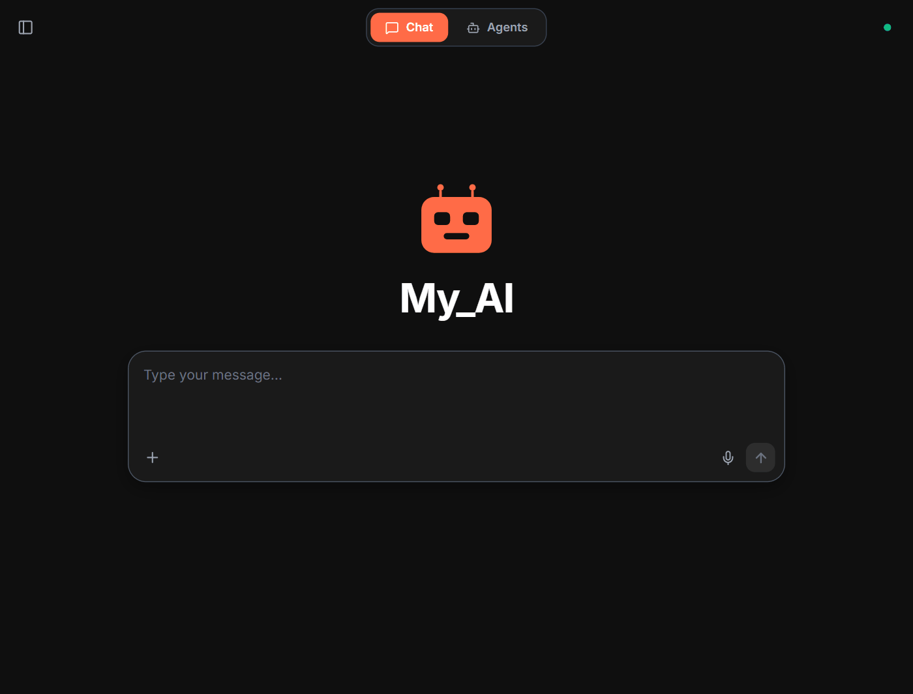
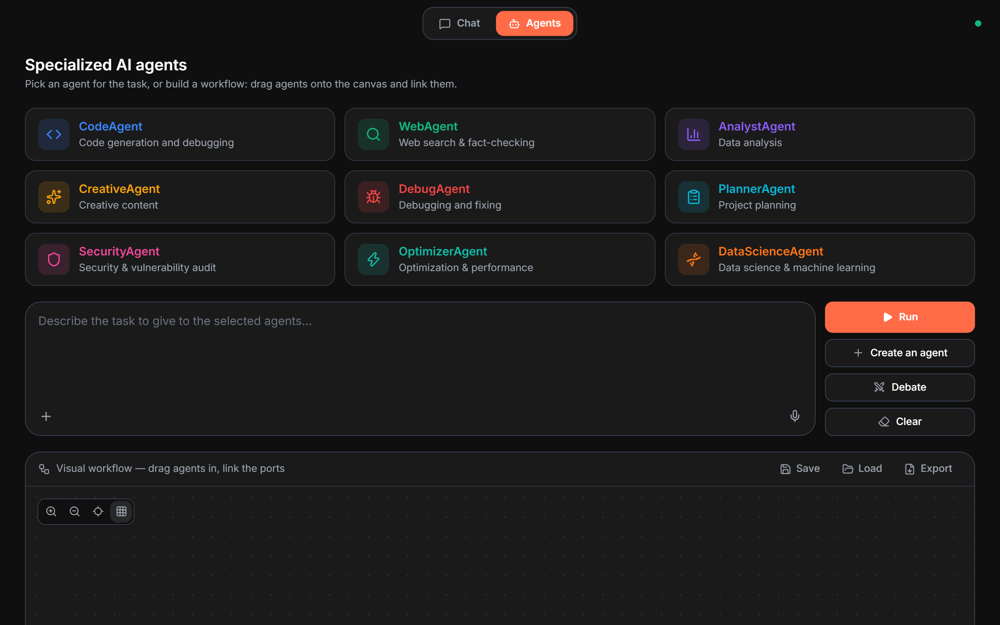
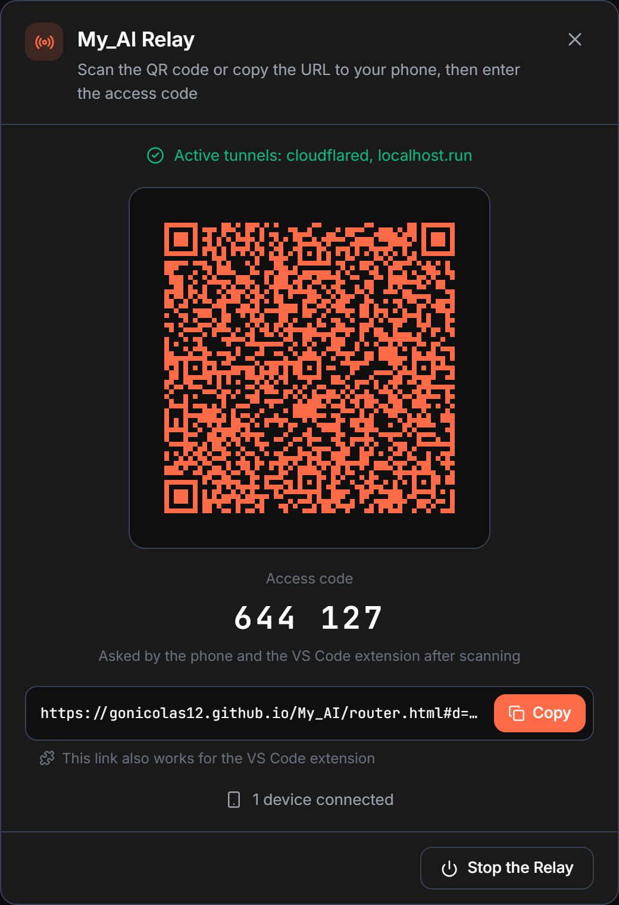
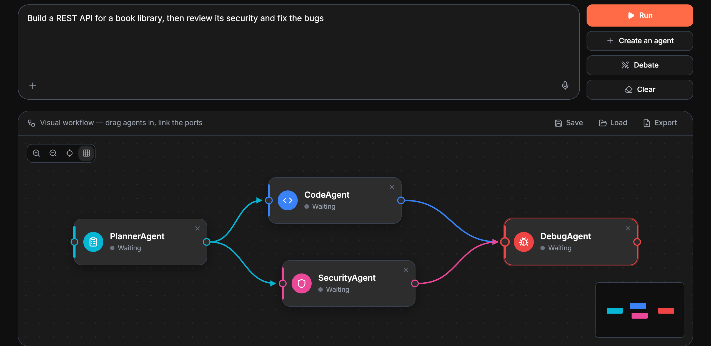

<div align="center">


# My_AI

### Your private AI assistant, running 100% on your computer

Chat, agents, documents, images and voice, powered by [Ollama](https://ollama.com).<br>
In 12 languages. Your conversations, files and memory stay on your machine.

[](https://github.com/gonicolas12/My_AI/stargazers)
[](https://github.com/gonicolas12/My_AI/releases)
[](https://www.python.org/)
[](https://ollama.com/download)
[](#-quick-start)
[](LICENSE)

**English** · [Français](README.fr.md)

[🚀 Quick start](#-quick-start) · [⚡ Features](#-features) · [🤖 Agents](#-ai-agents) · [📡 Mobile access](#-my_ai-relay--mobile-access) · [🧩 VS Code extension](#-vs-code-extension) · [📖 Documentation](#-documentation)



</div>

## ✨ Why My_AI?

- 🔒 **Private by design.** The model runs on your PC through Ollama. Conversations, documents and memory are stored locally (ChromaDB + SQLite). Once the models are downloaded, everything except web search and mobile access works offline.
- 🧩 **Everything in one window.** Chat with reasoning and cited web search, 9 specialized agents and a visual workflow editor, Word, PDF, Excel and PowerPoint generation, local image generation, voice input and output, scheduled tasks.
- 📱 **Wherever you work.** Talk to the AI running on your PC from your phone, through an end-to-end encrypted relay, or let it read and edit your project from VS Code.
- 🌍 **12 languages.** The interface, the answers, the voice and the generated documents follow your language: English, French, Spanish, German, Italian, Portuguese, Dutch, Russian, Chinese, Japanese, Korean and Arabic (right to left).
- 🪶 **Made for ordinary hardware.** On first launch, the setup wizard detects your RAM and GPU, then downloads the right model (2 to 9 billion parameters). My_AI checks whether your integrated GPU runs it faster and keeps the quickest option.

## 🖥️ Screenshots

<table>
<tr>
<td width="57%"></td>
<td rowspan="2"></td>
</tr>
<tr>
<td></td>
</tr>
<tr>
<td align="center"><b>Agents and visual workflows</b></td>
<td align="center"><b>Mobile access with the Relay</b></td>
</tr>
</table>

## 🚀 Quick start

**Requirements:** Python 3.10+ and [Ollama](https://ollama.com/download).

```bash
git clone https://github.com/gonicolas12/My_AI
cd My_AI
pip install -r requirements.txt
```

Then launch the app and choose **option 1 (graphical interface)**:

```bash
.\launch.bat      # Windows
./launch.sh       # macOS / Linux
```

On the **very first launch**, My_AI opens in your system language (one of the 12, English otherwise, and you can change it in the wizard), detects your hardware (RAM, CPU cores, GPU VRAM), **recommends and downloads** the right model, then creates `my_ai` for you. The window opens at once on a loading screen that names each step (Ollama, model, placement, engine), then switches to the chat.

> ⚠️ **Intel Mac (x86_64): Python 3.12 maximum.** PyTorch no longer publishes x86_64 builds after version 2.2.2, whose wheels stop at Python 3.12. On Python 3.13+, the installation fails. `launch.sh` checks this at startup. Apple Silicon, Windows and Linux are not affected.

> 💡 Without a launcher, `python launch_unified.py` (window + Ollama setup) and `python main.py --mode gui` (window only, with Ollama already running) work on all three systems. On Linux, the window needs GTK or Qt (`pip install "pywebview[qt]"`); without them, the interface opens in your browser.

<details>
<summary><b>Manual model setup</b></summary>

```bash
# Model (pick one for your RAM): it reads text and images
ollama pull qwen3.5:2b       # Ultra light, concise answers (4 GB RAM)
ollama pull qwen3.5:4b       # Recommended, light and fast (8 GB RAM)
ollama pull qwen3.5:9b       # Heavier, more detailed answers (16 GB RAM)

# Create the custom model
.\create_custom_model.bat
```

- 🖼️ **Images:** qwen3.5 sees them, so `my_ai` answers questions about an image itself, with no second model to download or keep in memory. A dedicated vision model (`ollama pull minicpm-v`, `llava`...) only takes over if the `Modelfile` is based on a model that can't see images.
- 🔄 **`Modelfile` changed?** (by hand, by a `git pull` or from ⚙️ Settings): `my_ai` is **recreated automatically at the next launch**, so there is no need to run `create_custom_model.bat` again. Launches do nothing more as long as the `Modelfile` doesn't change.
- **Switching models:** the easiest way is the **Settings panel** (bottom of the sidebar, or Ctrl+comma) → *Ollama models* → pick the model → *Apply* (regenerates `my_ai`, system prompt kept). By hand: change `llm.local.default_model` in `config.yaml` **and** the `FROM` line of the `Modelfile`, then restart My_AI: `my_ai` is recreated at launch.

</details>

<details>
<summary><b>🎮 GPU monitoring (optional)</b></summary>

GPU monitoring in the Agents tab needs extra packages **depending on your graphics card**:

```bash
# NVIDIA (needs the NVIDIA drivers)
pip install pynvml GPUtil

# AMD (needs ROCm or the AMDGPU drivers + Microsoft C++ Build Tools)
pip install pyamdgpuinfo

# Windows, any GPU (basic info: name, total VRAM)
pip install wmi
```

**Without these packages**, the app works normally: GPU metrics simply show "N/A".

</details>

<details>
<summary><b>🌐 Networks with a proxy (optional)</b></summary>

The project supports standard proxies through environment variables **and** through `config.yaml` (`network` section).

Examples (PowerShell):

```powershell
$env:HTTP_PROXY="http://proxy.company.com:8080"
$env:HTTPS_PROXY="http://proxy.company.com:8080"
$env:NO_PROXY="localhost,127.0.0.1,::1"
```

Examples (Linux/macOS):

```bash
export HTTP_PROXY="http://proxy.company.com:8080"
export HTTPS_PROXY="http://proxy.company.com:8080"
export NO_PROXY="localhost,127.0.0.1,::1"
```

If your proxy intercepts TLS, also set `network.ca_bundle` in `config.yaml` to the path of your root certificate (PEM). The `network.allow_insecure_ssl: true` mode exists as a last resort, but it is not recommended in production.

</details>

<details>
<summary><b>🧹 Clean-up if something goes wrong</b></summary>

```bash
.\clean_project.bat
```

If you notice unexpected behavior or errors after several launches, this script deletes all temporary files (logs, caches, histories) so you can start again from a clean slate.

</details>

## ⚡ Features

### 💬 Chat

| Feature | Details |
|---|---|
| 🧠 **Thinking mode** | For complex requests, the AI reasons step by step before answering: collapsible "Reasoning" block, animated while it generates |
| 🔍 **Web search** | Real-time information through DuckDuckGo (Yahoo and Wikipedia as fallbacks), with numbered, clickable sources `[n]` |
| 🎨 **Artifacts preview** | Side panel with a live rendering of HTML/CSS/SVG and of generated documents |
| ⚡ **Slash commands** | Type `/` at the start of a message to autocomplete reusable prompts; a short command is expanded into a detailed prompt when sent, while the chat bubble keeps the short command |
| 🎹 **Command palette** | Ctrl+K: every action of the app from the keyboard |
| 🧭 **Sidebar** | Conversations, global semantic search across all conversations, project folders, history |
| 💼 **Workspaces** | Isolated sessions saved automatically, export to Markdown, HTML and PDF in every language |
| 🎓 **RLHF feedback** | 1-5 star rating under each answer, automatic learning from your feedback |

### 🤖 AI agents

| Agent | Role |
|---|---|
| 🐍 **CodeAgent** | Code generation and debugging, in many languages |
| 🔍 **WebAgent** | Web search and fact-checking |
| 📊 **AnalystAgent** | Data analysis and insights |
| ✨ **CreativeAgent** | Writing and creative content |
| 🐛 **DebugAgent** | Error detection and fixing |
| 📋 **PlannerAgent** | Planning of complex projects |
| 🛡️ **SecurityAgent** | Security and vulnerability audit |
| ⚡ **OptimizerAgent** | Optimization and performance |
| 🧬 **DataScienceAgent** | Data science and machine learning |

- 🧩 **Custom agents**: describe the agent you need, and the local model writes its system prompt.
- 🔄 **Visual workflow canvas** (n8n style): connectable nodes, zoom/pan, grid, minimap; sequential, parallel or DAG execution.
- 🧵 **Run threads**: every run is a thread you can reopen.
- 🎭 **Debate mode**: two agents argue a topic against each other.
- 📊 **Statistics and resource monitoring**: CPU, RAM, GPU, VRAM, inference time and tokens/s.
- 📅 **Scheduled tasks**: run an agent, a workflow or a debate **on a schedule**, *daily*, *weekly*, at an *interval* or with **cron** (e.g. "every morning at 8, WebAgent on AI news, then summarize"). Optionally runs even when the app is closed, through the **Windows Task Scheduler**, with no admin rights and no stored password. Missed tasks catch up at restart, with notifications (OS toast + in-app entry + mobile message) and `.md` reports in `outputs/scheduled/`.
- 🔔 **Desktop notifications** when a long task finishes.

### 📝 Documents

- **Office documents**: "*generate a docx about whales*", "*make me a summary PDF*", "*create a PowerPoint presentation…*", "*a spreadsheet comparing…*". The local model writes, and python-docx, reportlab, python-pptx and openpyxl lay it out: headings, nested lists, styled tables, Word table of contents, automatic slide splitting, Excel sheets with filters.
- **In the document's language**: the "Generated on" line, table of contents, page numbers and sheet names follow the language of the text. The PDF picks the right font (Chinese, Japanese, Korean, Cyrillic, Arabic).
- **Editing attachments** (docx, xlsx, pptx, md, pdf…): replace a text, rewrite a section, add a row or a slide. **The original file is never touched**: the modified copy is written to `outputs/documents/`.
- **Native preview** in the side panel, opened automatically: the Word, PowerPoint and Excel viewers of Windows Explorer, and Edge's PDF reader. HTML rendering as a fallback elsewhere, and on the mobile Relay.
- **Reading files**: PDF (with OCR for scanned pages), DOCX, PowerPoint, Excel, CSV and code, with smart chunking for very long documents.

### 🎨 Local image generation (text → image)

- **Multimodal both ways**: the AI *sees* (Ollama vision) **and** *draws*. Ask "*generate an image of…*", "*draw me…*", "*create a logo…*".
- **Zero-config install**: on the first request without a backend, My_AI downloads and starts **portable ComfyUI** by itself (Windows: NVIDIA, AMD or Intel Arc build depending on the GPU, otherwise on the CPU; Python + torch embedded) plus a default model, just like the first-launch wizard does for Ollama.
- **100% local** through a **Stable Diffusion** HTTP backend: **ComfyUI** (auto-installed), **AUTOMATIC1111 / Forge**, or **diffusers** (optional, any GPU + CPU), set in `config.yaml` → `image_generation:`.

### 🎙️ Voice

- **Microphone button** in every input (home, conversation, Agents tab): the first click starts listening, the second one stops and transcribes, and the text is inserted at the cursor.
- **100% local** with [faster-whisper](https://github.com/SYSTRAN/faster-whisper): `small` model (~150 MB) loaded on demand, **language detected automatically** (99+ languages supported by Whisper).
- **Read aloud**: a button under each answer and an automatic reading mode, with a voice per language.

### 🧠 Memory you control

- **Vector memory of up to 10,485,760 tokens** (ChromaDB + SQLite), semantic search (sentence-transformers + cosine HNSW), smart chunking with overlap (256-token chunks, 32 overlap), automatic rolling summary at half of the context window (16k tokens out of 32k).
- **"Remember that…"** in the chat: the fact is really saved (Facts tab of the Memory panel), and useful facts then come with every answer.
- A **Memory** panel to **see, edit and delete** what the AI knows about you, with **real** CRUD operations, 100% local. **3 tabs**: **Facts** (SQLite), **Documents** and **Conversations** (ChromaDB vectors), with search, category filter, pagination and provenance (which session, which document).
- Deleting a vector entry is a **real deletion in ChromaDB** (`collection.delete`). For conversations, the **"delete at the source"** option removes the original message from the workspace for good.

### 📁 "@codebase" project context (persistent RAG)

- **Attach a whole folder** (a codebase or a docs folder) to a workspace: the AI keeps that context **available for every question**, with no need to drop the files again.
- **100% local incremental indexing**: reuses the vector memory (`codebase` collection) and the existing processors; **respects `.gitignore`** and skips `node_modules`, `.git`, `.venv`, `dist`… Only changed files are processed again when reindexing.
- **Retrieval at question time** (RAG), plus a **deterministic shortcut** for questions *about* the folder (path, list of files).
- **Window**: "Project folders" section of the sidebar. **VS Code**: the **`@`** menu attaches files and folders, one `@codebase` context per project.

### 🔌 MCP and full PC access

- **MCP (Model Context Protocol) integration**: standardized connection to local tools and external servers (files, git, databases).
- Local tools to **read, write and move files** and **create folders**, with the **full paths** returned by the tools checked carefully, so the AI can **organize workspaces** on its own.
- A **confirmation** dialog before any **file deletion**.

### 🦙 Ollama integration: 100% local LLM

- **Multiple models**: `qwen3.5:2b`, `qwen3.5:4b`, `qwen3.5:9b` (text **and** images), `mistral`...; a dedicated vision model (`minicpm-v`, `llava`, `llama3.2-vision`...) handles images only when the chosen model can't see them.
- **Automatic placement**: at launch, My_AI checks where Ollama puts the model. If it stays on the processor, My_AI measures whether the integrated GPU is faster and keeps the quicker one; when the model overflows the graphics card (or the integrated GPU), its context switches to 8 bits if that is faster. The choice is kept, and measured again after an Ollama update or a hardware change.
- **A single context window** (32,768 tokens, 65,536 as an option) for every call: Ollama no longer reloads the model from one step to the next and resumes the conversation it has already read.
- **Customizable model**: temperature, context and system prompt through the `Modelfile`.
- **Smart fallback**: without Ollama, the AI automatically switches to a patterns/rules mode.

### 🌐 And also

- 🌐 **REST API**: built-in FastAPI server for external integrations.
- 🎓 **RLHF, training pipeline and compression**: learning from feedback, fine-tuning with monitoring, detailed compression ratios ([advanced features](docs/ADVANCED_FEATURES.md)).
- 💻 **Cross-platform**: Windows · macOS · Linux.

## 📡 My_AI Relay — mobile access

Talk to your AI from your phone (iOS/Android), wherever you are, as long as the app is running on your PC.

### How it works

1. Click **Relay** at the bottom of the sidebar (or Ctrl+R)
2. My_AI Relay starts a WebSocket server and opens secure tunnels in parallel (cloudflared and localhost.run)
3. Scan the QR code or copy the URL to your phone, then enter the **access code** shown under the QR code
4. The mobile interface has two tabs at the top, **💬 Chat** and **🤖 Agents** (like the desktop app):
   - **Chat**: chat in real time; messages also appear on the PC. The send button turns into a **Stop button** during generation, and `[title](url)` links show up as clickable blue links.
   - **Agents**: the whole Agents page of the PC, made for touch: agent grid, **creating/editing/deleting custom agents**, **n8n-style visual workflow** (drag nodes, link ports), **Debate mode** and streamed runs.
5. Attach images, PDF, DOCX, PowerPoint, Excel or code files with the **+** button (in the Chat **and** on the Agents page): they go through the same processors as on the PC (vision model for images, vector context for documents)
6. Ask for a document ("*generate a pdf about…*"): its preview opens automatically in the modal, with a 💾 button to download the file

### Features

| Feature | Details |
|---|---|
| 📱 **Mobile interface** | Responsive PWA, dark theme, Chat / Agents tabs |
| 🤖 **Agents page** | 9 specialized agents + custom agents, visual workflow (sequential / parallel / DAG), Debate mode, run on the PC (local Ollama) and streamed to the phone |
| 🔒 **Authentication** | Random token in the QR code link, new at every start, plus a 6-digit **access code** shown under the QR code but not included in the link: a leaked link is not enough (5 attempts, then the Relay locks until it restarts) |
| 🛡️ **E2EE encryption** | Application-level AES-256-GCM on top of the tunnel: neither the tunnel services (Cloudflare, localhost.run) nor GitHub Pages can read the content (ephemeral key shared through the QR code) |
| 🌐 **Multi-tunnel** | cloudflared + localhost.run in parallel (serveo as an option), each one checked from the PC: only reachable tunnels go into the QR code; failover on the client side |
| 🔄 **Synchronization** | Chat messages visible in real time on the PC and the phone |
| ⚡ **WebSocket** | Instant communication, streaming, typing indicator, Stop button |
| 📎 **Attachments** | Chat + Agents: images + documents (PDF, DOCX, PPTX, XLSX, CSV, code) up to 25 MB, end-to-end encrypted, routed to vision + context |
| 📥 **Auto-install** | cloudflared is downloaded automatically if missing |

### Configuration (`config.yaml`)

```yaml
relay:
  auto_start: false      # Start automatically with the GUI
  port: 8765             # Relay server port
  response_timeout: 500  # Maximum AI response time (seconds)
  tunnel: true           # Enable the tunnels (tunnel_providers)
  tunnel_providers: ["cloudflared", "localhost.run"]  # "serveo" as an option, see docs/USAGE.md
  host: "0.0.0.0"        # Listening address
```

> **Without a tunnel** (`tunnel: false`, or no reachable provider), the Relay is only available on your local network.

## 🧩 VS Code extension

**My_AI Relay** is also available as an extension on the [**VS Code Marketplace**](https://marketplace.visualstudio.com/items?itemName=gonicolas12.my-ai). It does more than relay the chat: it offers an **agentic mode** where the local LLM (on the host PC) can read, edit and create files, run shell commands and search your VS Code workspace, with every action visible and approvable in the chat.

### How it works

1. On the host PC: start the Relay (**Relay** at the bottom of the sidebar, or Ctrl+R) → as soon as a tunnel answers, click **Copy** in the panel: the connection string is the QR code link
2. In VS Code: install the **My_AI Relay** extension from the Marketplace → open its view in the sidebar → **Paste the connection string** → enter the **access code** shown under the QR code
3. Once connected, the extension identifies itself as a `vscode` client to the Relay and turns on the agentic mode. Ask for example *"scaffold a Vite + React project with a router and a Header component"*: you will see each `write_file` / `run_command` appear as an expandable card in the chat, with an approval request for destructive operations.

> **One Code conversation, three places.** The VS Code conversation also shows on the **Code** page of the desktop app (**Code** button at the top of the sidebar) and in the **Code** view of the phone (`</>` button left of **Chat**): messages typed there go to the extension, which acts in its workspace, and the reply streams everywhere. On the desktop page, messages can carry the chat's attachments (documents, code, images described by the vision model) and be dictated with the local voice input. A write or a shell command asked from the PC or the phone waits for an approval that can be given from any of the three. The regular chat (phone + desktop) stays separate: nothing of it reaches VS Code, and the other way round. The regular chat keeps the classic pipeline with the full local MCP tools: the agentic mode is exclusive to the Code conversation.

### Features

| Feature | Details |
|---|---|
| 🤖 **Agentic mode** | 9 tools exposed to the LLM (`read_file`, `write_file`, `edit_file`, `list_dir`, `glob`, `grep`, `run_command`, `get_active_editor`, `open_file`) with a multi-step reasoning loop |
| 📎 **`@` menu** | Typing `@` attaches a file to the message, or a **folder** as a persistent **@codebase** context (indexed on the host, one context per project) |
| ⚡ **Slash commands** | `/` autocompletion of the My_AI prompts, expanded into a detailed prompt when sent (the bubble keeps the short command) |
| ⏹️ **STOP button** | Stops the whole turn in one click: the LLM **and** the agentic tool loop (pending calls included). **Clear** during a generation stops it too |
| 🛟 **Loop guard** | Detects repeated rewrites of the same file so an agent doesn't go round in circles |
| 🛡️ **Workspace sandbox** | Every path is resolved from the open VS Code workspace. Going outside the workspace needs a modal approval per path |
| ✋ **Granular approvals** | Reads approved automatically, writes and shell commands behind a modal with *Once* / *For this file* / *Allow everything for this tool this session*; for a message typed on the PC or the phone, the same choices as buttons under the tool call, on VS Code, the PC and the phone |
| 🎴 **Tool calls inside the reply** | One bubble per reply: its text, then its tool calls one line each (spinner = running · lock = awaiting approval · tool icon = OK · red = error · grey = denied), input and output on click; the same rendering in VS Code and on the phone |
| 🧠 **Shared memory** | One conversation for VS Code, the desktop **Code** page and the phone, kept across reconnections and restarts ("edit the file you just read" works); **Clear** starts a new one everywhere |
| 🔧 **Works with any Ollama model** | `<tool_use>{...}</tool_use>` format parsed on the host, no need for Ollama's native tools API |
| 🔐 **E2EE encryption** | Same AES-256-GCM as the phone: the tunnel only sees ciphertext |
| 🌐 **Multi-tunnel failover** | cloudflared / localhost.run (serveo as an option) pinged from the client, automatic switch |
| 💾 **Persistence** | Credentials encrypted in VS Code's SecretStorage (OS keychain) |
| 🔄 **Auto-reconnect** | Detects when the host Relay stops, reconnects automatically when it restarts |
| 🌍 **12 languages** | The extension speaks My_AI's language (chosen in its Settings), like the desktop app and the phone; command titles follow VS Code's display language |
| 🆓 **Open source** | Code in [`vscode_extension/`](vscode_extension/), MIT license |

### Installation

```
# From VS Code: Extensions (Ctrl+Shift+X) → search "My_AI Relay" → Install
# OR from the command line:
code --install-extension gonicolas12.my-ai
```

> See [`vscode_extension/README.md`](vscode_extension/README.md) (English) or [`vscode_extension/README.fr.md`](vscode_extension/README.fr.md) (French) for the full documentation, the complete list of tools and the details of the approval flow.

## 📖 Documentation

The detailed guides are written in French for now.

| Document | Description |
|---|---|
| [🏗️ Architecture](docs/ARCHITECTURE.md) | Detailed technical structure, full file tree |
| [📦 Installation](docs/INSTALLATION.md) | Complete installation guide |
| [🔍 Web search](docs/INTERNET_SEARCH.md) | Everything about web search |
| [⚡ Optimization](docs/OPTIMIZATION.md) | Tips and techniques for local performance |
| [💾 10M vector memory](docs/ULTRA_10M_TOKENS.md) | How the extended internal memory works |
| [🧠 Memory (control)](docs/MEMORY.md) | See / edit / delete what the AI knows (facts + vectors) |
| [🔎 Global search](docs/CONVERSATION_SEARCH.md) | Semantic search across all conversations |
| [⚡ Prompt library](docs/PROMPT_LIBRARY.md) | Slash commands |
| [📁 @codebase context](docs/CODEBASE.md) | Attaching a whole project folder as persistent RAG |
| [📋 Usage](docs/USAGE.md) | Usage examples and workflows |
| [📝 Changelog](docs/CHANGELOG.md) | Update history |
| [❓ FAQ](docs/FAQ.md) | Frequently asked questions with detailed answers |
| [📄 File generation](docs/FILE_GENERATION.md) | Generating files with the AI |
| [📄 Document generation](docs/DOCUMENT_GENERATION.md) | Word/PDF/PowerPoint/Excel: creation, editing, preview |
| [🎨 Image generation](docs/IMAGE_GENERATION.md) | 100% local text → image (backends, auto-install, GPU) |
| [🤖 AI agents](docs/AGENTS.md) | Full documentation of the specialized agents |
| [🎨 Agents GUI](docs/AGENTS_GUI.md) | Guide to the agents interface |
| [🎨 Artifacts preview](docs/ARTIFACTS_PREVIEW.md) | Live HTML/CSS/SVG and document rendering panel |
| [📅 Scheduled tasks](docs/SCHEDULER.md) | Proactive scheduler: recurring agents/workflows (cron) |
| [🔌 MCP integration](docs/MCP_INTEGRATION.md) | Guide to the Model Context Protocol |
| [🎓 Advanced features](docs/ADVANCED_FEATURES.md) | RLHF, training, compression |
| [💬 Feedback GUI](docs/GUI_RLHF_FEEDBACK.md) | 1-5 star rating of answers in the window |
| [🧩 VS Code extension](vscode_extension/README.md) | Full documentation of the VS Code extension (in English), [French version](vscode_extension/README.fr.md) |

## 🏗️ Architecture

```
My_AI/
├── core/              # AI engine, chat and agent orchestration, memory, scheduler, REST API
├── frontend/          # Web interface (React + TypeScript, Vite), built into frontend/dist
├── interfaces/        # Native window (pywebview) and its local server, CLI
├── models/            # Agents, Ollama manager, web search, image generation
├── processors/        # Readers for PDF (OCR), DOCX, PowerPoint, Excel and code
├── generators/        # Word/PDF/PowerPoint/Excel generation and editing
├── memory/            # Vector memory (ChromaDB)
├── relay/             # My_AI Relay: mobile access server and PWA
├── vscode_extension/  # VS Code extension (Relay client, agentic mode)
├── utils/ · tools/    # Utilities, model placement, cloudflared, demo server
├── main.py · launch_unified.py · launch.bat · launch.sh
└── config.yaml · Modelfile
```

The file-by-file tree and the processing flows are in [docs/ARCHITECTURE.md](docs/ARCHITECTURE.md).

## 🗺️ Roadmap

- 🔊 **Voice**: voice output on mobile/Relay and a hands-free conversation mode (dictation → answer → read aloud, in a loop)
- 🧩 **VS Code extension**: integration with VS Code diagnostics (Problems panel), before/after diffs for edits, dedicated terminals for `run_command`
- 🧠 **Better reasoning engine** (Thinking mode)
- 🔗 **Third-party API integrations**

## 🤝 Contributing

Issues and pull requests are welcome. For a large change, please open an issue first so we can discuss it. A bug report with steps to reproduce helps a lot.

If My_AI is useful to you, a ⭐ on GitHub helps other people find it.

## 📄 License

[MIT](LICENSE)

<div align="center">

*Built with ❤️ to stay local, private and powerful.*

</div>
