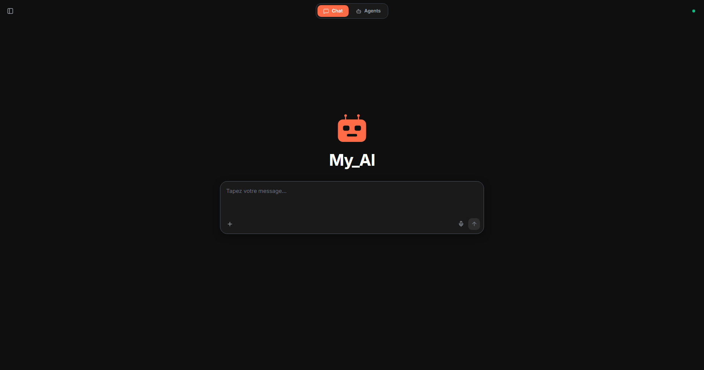
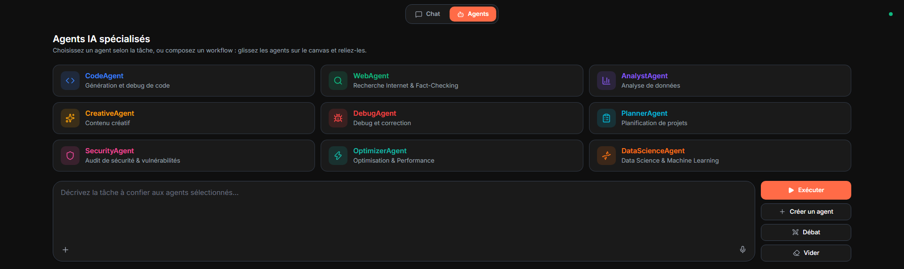
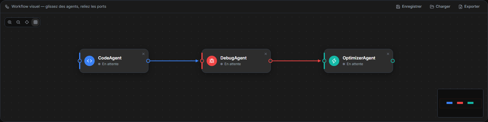

<div align="center">

# 🤖 My AI — Une IA personnelle, confidentielle et locale

**Puissante · Locale · Extensible**

[](https://www.python.org/)
[](https://ollama.com/download)
[](https://github.com/gonicolas12/My_AI)
[](LICENSE)
[](docs/ULTRA_10M_TOKENS.md)

*Une IA qui tourne entièrement sur votre machine. Vos données ne quittent jamais votre ordinateur.*

[🚀 Démarrage rapide](#-démarrage-rapide) · [🤖 Agents IA](#-système-dagents-ia-spécialisés) · [📡 My_AI Relay](#-my_ai-relay--accès-mobile) · [🧩 Extension VS Code](#-extension-vs-code) · [📖 Documentation](#-documentation-complète)

</div>

---

## ✨ Points Forts

<table>
<tr>
<td width="50%">

**💾 Mémoire Vectorielle Étendue**  
Jusqu'à 10 485 760 tokens stockés en mémoire interne (ChromaDB + SQLite).

**🤖 9 Agents IA Spécialisés**  
Code, Debug, Web, Sécurité... et création d'agents personnalisés avec interface style n8n.

**🧠 Mode Thinking**  
Pour les requêtes complexes, l'IA réfléchit étape par étape avant de répondre.

**🔌 Intégration MCP (Model Context Protocol)**  
Connexion standardisée à des outils locaux et serveurs externes (fichiers, git, bases de données).

**📅 Tâches Planifiées (proactif)**  
Planifiez vos agents et workflows en récurrence, exécution même l'application fermée.

</td>
<td width="50%">

**🔍 Recherche Internet**  
Informations en temps réel via DuckDuckGo (Yahoo et Wikipédia en secours).

**📄 Génération et traitement de Documents**  
PDF, DOCX, PowerPoint, Excel, CSV, Code, images, analyse contextuelle ultra-étendue.

**📡 Accès Mobile**  
Discutez avec votre IA depuis votre téléphone, où que vous soyez, via un tunnel sécurisé.

**💻 Extension VS Code agentique**  
Lecture, édition, création de fichiers... le tout via le tunnel chiffré.

**🎙️ Voix locale**  
Dictée via faster-whisper dans toutes les zones de saisie, et lecture vocale des réponses.

</td>
</tr>
</table>

---

## 🖥️ Interface Utilisateur

<div align="center">

### Chat — Interface moderne



| Fonctionnalité | Détail |
|---|---|
| 🧠 **Mode Thinking** | Bloc « Réflexion » repliable : texte animé pendant la génération |
| 🧭 **Barre latérale** | Conversations, recherche globale, dossiers du projet, historique... |
| 🎓 **Feedback RLHF** | Notation 1-5 étoiles sous chaque réponse |
| 🎙️ **Saisie vocale** | Bouton micro dans chaque zone de saisie, transcription locale |
| 🔊 **Lecture vocale** | Bouton sous chaque réponse + mode lecture auto |
| 🎨 **Aperçu Artifacts** | Volet de rendu live HTML/CSS/SVG et des documents générés |
| ⚡ **Slash commands** | Tapez `/` : autocomplétion de prompts réutilisables |
| 🎹 **Palette de commandes** | Ctrl+K : toutes les actions de l'appli au clavier |

### Agents — Interface dédiée




| Fonctionnalité | Détail |
|---|---|
| 🤖 **Vue d'ensemble** | Grille de tous les agents avec descriptions |
| 🧩 **Création d'agents personnalisés** | Prompt système rédigé par le modèle local |
| 🔄 **Canvas de workflow visuel** | Nœuds connectables, zoom/pan, grille, minimap |
| 🧵 **Fils d'exécution** | Chaque exécution est un fil rouvrable |
| 🎭 **Mode Débat** | Confrontation argumentée entre deux agents |
| 📊 **Statistiques et monitoring ressources** | CPU, RAM, GPU, VRAM, temps d'inférence et tokens/s |
| 📅 **Tâches planifiées** | Agents en récurrence, même l'appli fermée |
| 🔔 **Notifications desktop** | Notification système à la fin d'une tâche longue |

</div>

---

## ⚡ Fonctionnalités Principales

### 🤖 Système d'Agents IA Spécialisés

| Agent | Rôle |
|---|---|
| 🐍 **CodeAgent** | Génération et debug de code multi-langages |
| 🔍 **WebAgent** | Recherche Internet & Fact-Checking |
| 📊 **AnalystAgent** | Analyse de données et insights |
| ✨ **CreativeAgent** | Rédaction et contenu créatif |
| 🐛 **DebugAgent** | Détection et correction d'erreurs |
| 📋 **PlannerAgent** | Planification de projets complexes |
| 🛡️ **SecurityAgent** | Audit de sécurité & vulnérabilités |
| ⚡ **OptimizerAgent** | Optimisation & Performance |
| 🧬 **DataScienceAgent** | Data Science & Machine Learning |

### 🦙 Intégration Ollama — LLM 100% Local

- **Confidentialité totale** : aucune donnée envoyée sur internet
- **Fallback intelligent** : sans Ollama, l'IA bascule automatiquement en mode patterns/règles
- **Modèle personnalisable** : température, contexte, system prompt via le `Modelfile`
- **Multi-modèles** : texte (`qwen3.5:2b`, `qwen3.5:4b`, `mistral`...) et vision (`minicpm-v`, `llava`, `llama3.2-vision`...)
- **Placement automatique** : au lancement, My_AI regarde où Ollama place le modèle. Resté sur le processeur, il mesure si le GPU intégré va plus vite et garde le plus rapide ; quand le modèle déborde de la carte graphique (ou du GPU intégré), son contexte passe en 8 bits s'il va plus vite. Le choix est gardé, et remesuré après une mise à jour d'Ollama ou un changement de matériel.
- **Une seule fenêtre de contexte** (32 768 tokens, 65 536 en option) pour tous les appels : Ollama ne recharge plus le modèle d'une étape à l'autre et reprend la conversation déjà lue.

### 🎨 Génération d'images locale (texte → image)

- **Symétrie multimodale** : l'IA *voit* (vision Ollama) **et** *dessine*. Demandez « *génère une image de…* », « *dessine-moi…* », « *crée un logo…* ».
- **Installation automatique (zéro config)** : à la première demande sans backend, My_AI télécharge et lance **ComfyUI portable** tout seul (Windows : build NVIDIA, AMD ou Intel Arc selon le GPU, sinon sur le CPU ; Python+torch embarqués) + un modèle par défaut — comme l'assistant de premier lancement pour Ollama.
- **100% local** via un backend **Stable Diffusion** en HTTP : **ComfyUI** (auto-installé), **AUTOMATIC1111 / Forge**, ou **diffusers** (optionnel, tous GPU + CPU), configurable dans `config.yaml` → `image_generation:`.

### 📝 Génération & modification de documents

- **Documents bureautiques** : « *génère moi un docx sur les baleines* », « *fais-moi un PDF de synthèse* », « *crée une présentation PowerPoint…* », « *un tableur Excel comparant…* ». Le modèle local rédige, python-docx, reportlab, python-pptx et openpyxl mettent en forme : titres, listes imbriquées, tableaux stylés, sommaire Word, découpe automatique des diapos, onglets Excel avec filtre.
- **Modification des pièces jointes** (docx, xlsx, pptx, md, pdf…) : remplacer un texte, réécrire une section, ajouter une ligne ou une diapo. **Le fichier d'origine n'est jamais touché** : la copie modifiée est écrite dans `outputs/documents/`.
- **Aperçu au format natif** dans le volet latéral, ouvert automatiquement : visionneuses Word, PowerPoint et Excel de l'Explorateur Windows, lecteur PDF d'Edge. Rendu HTML de repli ailleurs, et sur le mobile Relay.

### 🔌 Accès à tout le PC (Root System) via MCP Local
- Outils locaux pour **lire, écrire, déplacer des fichiers** et **créer des dossiers**
- Vérification rigoureuse des **chemins complets** retournés par les outils pour garantir une **gestion précise** des fichiers
- Capacité à **organiser les espaces de travail** de manière autonome
- Dialogue de **confirmation** avant toute **suppression de fichier** (sécurité utilisateur)

### ⚡ Slash commands & Bibliothèque de prompts

- **Tapez `/`** en début de saisie : autocomplétion des **prompts réutilisables** (`/code`, `/résume`, `/traduis`, `/explique`, `/corrige`, `/reformule`…), navigables au clavier.
- **Prompt engineering, pas du texte pré-rempli** : une **commande courte** (`/code un jeu de morpion`) est **expansée à l'envoi** en un prompt détaillé pour le modèle — la bulle de chat, elle, garde la commande courte.
- **Gérez votre bibliothèque** : créez, nommez, éditez et supprimez vos templates (placeholder `{arguments}` pour injecter le texte saisi).
- Disponible **partout** : GUI desktop, **mobile** (Relay, via `GET /api/prompts` chiffré) et **extension VS Code**.

### 📁 Contexte projet « @codebase » (RAG persistant)

- **Attachez un dossier entier** (codebase ou dossier de docs) à un workspace : l'IA garde ce contexte **disponible en permanence** pour toutes les questions — plus besoin de re-glisser les fichiers.
- **Indexation incrémentale 100% local** : réutilise la mémoire vectorielle (collection `codebase`) et les processeurs existants ; **respecte `.gitignore`** et exclut `node_modules`, `.git`, `.venv`, `dist`… Seuls les fichiers modifiés sont retraités au réindex.
- **Récupération au moment de la question** (RAG) + **court-circuit déterministe** pour les questions *sur* le dossier (chemin, liste de fichiers).
- **Fenêtre** : section « Dossiers du projet » de la barre latérale. **VS Code** : menu **`@`** pour attacher fichiers/dossiers, un seul contexte `@codebase` par projet.

### 🎙️ Saisie Vocale (Voice Mode)

- **Bouton micro** dans chaque zone de saisie (accueil, conversation, onglet Agents)
- **Toggle** : 1er clic démarre l'écoute, 2ème clic stoppe et lance la transcription
- **100% local** via [faster-whisper](https://github.com/SYSTRAN/faster-whisper) — modèle `small` (~150 Mo) chargé à la demande
- **Langue auto-détectée** (99+ langues supportées par Whisper)
- **Insertion au curseur** de la zone active — pratique pour dicter des prompts longs sans interrompre sa frappe

### 📅 Tâches Planifiées (assistant proactif)

- Planifiez l'exécution **récurrente** d'un **agent**, d'un **workflow** (canvas n8n) ou d'un **débat** : *quotidien*, *hebdomadaire*, *intervalle* ou **cron** — ex. « chaque matin 8h, WebAgent sur l'actu IA et résume »
- **Exécution même l'application fermée** (option) via le **Planificateur de tâches Windows** — session ouverte, sans droits admin ni mot de passe stocké
- **Rattrapage** des tâches manquées au redémarrage, **notifications** (toast OS + entrée GUI + message mobile), rapports `.md` dans `outputs/scheduled/`
- 100% local, **réutilise l'orchestrateur d'agents existant**.

### 🧠 Contrôle total de la mémoire (confidentialité)

- **« Retiens que… »** dans le chat : le fait est vraiment enregistré (onglet Faits du panneau Mémoire), et les faits utiles accompagnent ensuite chaque réponse.
- Un panneau **Mémoire** pour **voir, éditer et supprimer** ce que l'IA sait de vous — **vraies** opérations CRUD, 100% local, **sans mock**.
- **3 onglets** : **Faits** (SQLite), **Documents** et **Conversations** (vecteurs ChromaDB), avec **recherche, filtre par catégorie, pagination et provenance** (quelle session / quel document).
- **Édition inline** et **suppression confirmée** (dialogue cohérent avec la confirmation MCP). Pour les conversations, option **« supprimer à la source »** = suppression **durable** (le message d'origine est retiré du workspace puis réindexé, il ne réapparaît pas).
- La suppression d'une entrée vectorielle est une **vraie suppression dans ChromaDB** (`collection.delete`).

---

## 💥 Capacités Techniques


| Capacité | Valeur |
|---|---|
| **💾 Mémoire vectorielle interne** | jusqu'à **10 485 760 tokens** |
| **📝 Résumé glissant** | automatique à la moitié de la fenêtre de contexte (16k tokens sur 32k) |
| **🔍 Recherche sémantique** | sentence-transformers + HNSW cosinus |
| **🗃️ Base vectorielle** | ChromaDB (local) |


- **Chunking intelligent** avec chevauchement configurable (chunk 256 tokens, overlap 32)
- **Auto-optimisation** de la mémoire selon l'usage (éviction FIFO)
- **Métriques de chunking exposées** : overhead de chevauchement, taille moyenne des chunks

---

## 🏗️ Architecture du Projet

```
my_ai/
├── core/                                # Cœur de l'IA
│   ├── __init__.py
│   ├── agent_orchestrator.py            # Orchestrateur d'agents
│   ├── agentic_executor.py              # Exécuteur agentique (outils distants via Relay)
│   ├── ai_engine.py                     # Moteur principal IA
│   ├── api_server.py                    # Serveur API REST (FastAPI)
│   ├── chat_orchestrator.py             # Orchestrateur de chat (ReAct + Plan & Execute)
│   ├── chat_service.py                  # Service de chat sans interface (fenêtre et mobile)
│   ├── command_history.py               # Historique des commandes utilisateur
│   ├── compression_monitor.py           # Moniteur de compression (ratios, métriques)
│   ├── config.py                        # Gestion de la configuration
│   ├── conversation_exporter.py         # Export conversations (MD/HTML/PDF)
│   ├── conversation.py                  # Gestion des conversations
│   ├── conversation_search.py           # Recherche sémantique globale cross-conversations
│   ├── data_preprocessing.py            # Prétraitement des données
│   ├── document_passages.py             # Passages d'un long document selon la question
│   ├── error_analysis.py                # Analyse des erreurs et feedback RLHF
│   ├── evaluation.py                    # Évaluation des performances
│   ├── folder_indexer.py                # Indexeur incrémental de dossier rattaché au workspace
│   ├── knowledge_base_manager.py        # Base de connaissances structurée
│   ├── language_detector.py             # Détection automatique de langue
│   ├── mcp_client.py                    # Client Model Context Protocol (Outils)
│   ├── memory_store.py                  # Couche d'accès CRUD unifiée mémoire (faits + vecteurs)
│   ├── modelfile.py                     # SYSTEM du Modelfile en tête des prompts système
│   ├── network.py                       # Gestion des connexions réseau et proxys
│   ├── optimization.py                  # Optimisation des performances
│   ├── passage_embeddings.py            # Modèle multilingue des passages (téléchargé au lancement)
│   ├── platform_paths.py                # Exemples de chemins adaptés à l'OS (prompts)
│   ├── prompt_library.py                # Bibliothèque de prompts / slash commands
│   ├── rlhf_manager.py                  # RLHF intégré (feedback automatique)
│   ├── scheduler.py                     # Scheduler proactif (tâches planifiées récurrentes)
│   ├── scheduler_runner.py              # Runner headless + Planificateur de tâches Windows
│   ├── session_manager.py               # Gestionnaire de workspaces/sessions
│   ├── shared.py                        # Modules partagés
│   ├── training_manager.py              # Training Manager moderne (pipeline complet)
│   ├── training_pipeline.py             # Pipeline d'entraînement local
│   ├── validation.py                    # Validation des entrées utilisateur
│   └── web_cache.py                     # Cache web persistant (diskcache)
├── data/                                # Données persistantes
│   ├── knowledge_base/                  # Base de faits (SQLite)
│   ├── web_cache/                       # Cache des recherches web
│   └── workspaces/                      # Espaces de travail sauvegardés
├── docs/                                # Documentations
├── examples/                            # Exemples d'utilisation
│   └── advanced_features_demo.py        # Démonstration des fonctionnalités avancées
├── generators/                          # Générateurs de contenu
│   ├── __init__.py
│   ├── code_generator.py                # Génération code avec analyse ultra
│   ├── document_editor.py               # Modification de documents joints (toujours sur une copie)
│   ├── document_generator.py            # Documents Word/PDF/PowerPoint/Excel rédigés par le LLM
│   └── markdown_document.py             # Parseur Markdown → blocs, socle des backends de rendu
├── frontend/                            # Interface web (React + TypeScript, Vite)
│   ├── src/
│   │   ├── features/                    # Pages Chat et Agents, panneaux, aperçu, palette, assistant
│   │   ├── lib/                         # Client REST, WebSocket, pont vers la fenêtre (shell)
│   │   ├── stores/                      # État de l'interface (Zustand)
│   │   └── styles/tokens.css            # Couleurs, typographie, rayons (jetons de l'interface)
│   ├── scripts/                         # Vérifications Playwright (développement)
│   └── dist/                            # Build versionné : Node n'est pas requis pour lancer l'appli
├── interfaces/                          # Interfaces utilisateur
│   ├── desktop/                         # Fenêtre de l'appli et son serveur local
│   │   ├── __init__.py
│   │   ├── _whisper_worker.py           # Transcription isolée (contournement OpenMP macOS)
│   │   ├── agents.py                    # Page Agents : fils d'exécution, workflows, débat...
│   │   ├── api_*.py                     # Routes REST
│   │   ├── devserver.py                 # Serveur Vite du mode développement (--dev)
│   │   ├── dpi_host.py                  # Fenêtre hôte DPI par écran, repli des visionneuses
│   │   ├── events.py                    # Protocole d'événements du WebSocket (Pydantic)
│   │   ├── files.py                     # Fichiers locaux : liens signés, ouverture, Explorateur
│   │   ├── folders.py                   # Dossiers du projet de la session
│   │   ├── lifecycle.py                 # Étapes du lancement, moteur, Relay, scheduler
│   │   ├── memory.py                    # Panneau Mémoire (faits/documents/conversations)
│   │   ├── model_setup.py               # Modèles Ollama et assistant de premier lancement
│   │   ├── native_viewer.py             # Visionneuses Office dans le volet d'aperçu
│   │   ├── preview_handler.py           # Visionneuses natives Word/PowerPoint/Excel
│   │   ├── previews.py                  # Pages d'aperçu : artifacts HTML/SVG et documents
│   │   ├── prompts.py                   # Bibliothèque de prompts
│   │   ├── qr.py                        # QR code du Relay
│   │   ├── resources.py                 # Moniteur de ressources (CPU/RAM/GPU) de la page Agents
│   │   ├── routing.py                   # Aides communes aux routes
│   │   ├── schedule.py                  # Tâches planifiées de la page Agents
│   │   ├── server.py                    # Serveur FastAPI local (127.0.0.1, jeton)
│   │   ├── settings.py                  # Réglages (config.yaml, commentaires préservés)
│   │   ├── shell_api.py                 # Fonctions de la fenêtre exposées à la page (dialogues…)
│   │   ├── voice.py                     # Voix : saisie (Whisper) et lecture (pyttsx3)
│   │   ├── voice_input.py               # Saisie vocale (faster-whisper + sounddevice)
│   │   ├── voice_output.py              # Sortie vocale / TTS (pyttsx3, voix par langue)
│   │   └── window.py                    # Fenêtre native (pywebview), repli sur le navigateur
│   ├── __init__.py
│   ├── artifacts.py                     # Détection/préparation des artifacts (HTML, SVG, documents)
│   ├── cli.py                           # Interface ligne de commande
│   ├── document_preview.py              # Rendu HTML des documents (aperçu de repli, mobile)
│   ├── onboarding.py                    # Fonctions de l'assistant de premier lancement
│   └── resource_monitor.py              # Monitoring ressources système (CPU/RAM/GPU)
├── vscode_extension/                    # Extension VS Code (client Relay distant)
│   ├── package.json                     # Manifest extension + commandes
│   ├── src/                             # Code TypeScript (extension Node.js host)
│   ├── media/                           # Webview UI (HTML/CSS/JS)
│   └── README.md                        # Doc Marketplace
├── memory/                              # Mémoire vectorielle
│   ├── vector_store/chroma_db/          # Base de données ChromaDB
│   ├── __init__.py
│   └── vector_memory.py                 # Mémoire vectorielle avec ChromaDB
├── models/                              # Modèles d'IA
│   ├── mixins/                          # Mixins (recherche internet, etc.)
│   ├── training_runs/                   # Enregistrements des runs d'entraînement
│   ├── weights/                         # Poids de modèles entraînés localement
│   ├── __init__.py
│   ├── advanced_code_generator.py       # Générateur de code avancé
│   ├── ai_agents.py                     # Agents IA spécialisés
│   ├── base_ai.py                       # Interface de base
│   ├── conversation_memory.py           # Mémoire conversationnelle avancée
│   ├── comfyui_manager.py               # Auto-installation/gestion de ComfyUI portable (image)
│   ├── custom_ai_model.py               # Modèle IA principal avec intentions
│   ├── image_generation.py              # Génération d'images locale (texte → image, SD)
│   ├── intelligent_code_orchestrator.py # Orchestrateur pour la génération de code
│   ├── intelligent_document_analyzer.py # Analyseur de documents intelligent
│   ├── internet_search.py               # Moteur de recherche internet
│   ├── knowledge_base.py                # Base de connaissances locale
│   ├── linguistic_patterns.py           # Reconnaissance d'intentions et patterns
│   ├── local_llm.py                     # Gestionnaire Ollama (détection + fallback)
│   ├── real_web_code_generator.py       # Générateur de Code Basé sur Recherche Web Pure
│   ├── smart_code_searcher.py           # Recherche de code intelligente
│   └── smart_web_searcher.py            # Système de Recherche Web Intelligent pour Code
├── outputs/                             # Fichiers générés par l'IA
│   ├── documents/                       # Documents générés ou modifiés (docx, pdf, pptx, xlsx…)
│   └── exports/                         # Conversations exportées (MD/HTML/PDF)
├── processors/                          # Processeurs de fichiers
│   ├── __init__.py
│   ├── attachments.py                   # Lecture des pièces jointes des agents (fenêtre + mobile)
│   ├── code_processor.py                # Traitement de code avec analyse sémantique
│   ├── docx_processor.py                # Traitement DOCX avec compression
│   ├── excel_processor.py               # Traitement Excel (.xlsx, .xls) et CSV
│   ├── ocr.py                           # OCR des pages PDF scannées (RapidOCR)
│   ├── path_resolution.py               # Résolution des chemins OneDrive (partagée docx/pptx)
│   ├── pdf_processor.py                 # Traitement PDF avec chunking intelligent
│   └── pptx_processor.py                # Lecture PowerPoint (titres, puces, tableaux, notes)
├── relay/                               # My_AI Relay (accès mobile)
│   ├── __init__.py
│   ├── relay_bridge.py                  # Pont de synchronisation appli ↔ mobile
│   ├── relay_server.py                  # Serveur FastAPI + WebSocket + tunnel
│   ├── agent_relay.py                   # Service Agents serveur (workflow/débat/CRUD)
│   └── static/
│       ├── index.html                   # Interface mobile PWA (onglets Chat/Agents)
│       ├── style.css                    # Styles de l'interface mobile
│       ├── app.js                       # Logique WebSocket et chat
│       └── agents.js                    # Page Agents mobile (grille, canvas n8n, débat)
├── tests/                               # Tests unitaires
├── tools/                               # Outils (cloudflared pour le Relay)
│   ├── interface_web/                   # Serveur de démonstration de la fenêtre, sans Ollama
│   ├── __init__.py
│   ├── clean_broken_dist_info.py        # Répare un environnement après un pip interrompu
│   ├── local_tools.py                   # Outils locaux
│   └── measure_energy.py                # Empreinte énergétique et carbone d'une session
├── utils/                               # Utilitaires
│   ├── __init__.py
│   ├── citations.py                     # Citations web numérotées cliquables ([n] → url)
│   ├── desktop_notify.py                # Notifications desktop natives (winotify/plyer)
│   ├── file_manager.py                  # Gestion fichiers
│   ├── file_processor.py                # Gestion traitement fichiers
│   ├── intelligent_calculator.py        # Calculateur intelligent
│   ├── logger.py                        # Gestion des logs
│   ├── ollama_placement.py              # Placement du modèle (carte, GPU intégré, processeur)
│   ├── path_links.py                    # Chemins de fichiers cliquables dans les réponses
│   └── requirements_sync.py             # Installe au lancement les dépendances ajoutées (git pull)
├── main.py                              # Point d'entrée principal (CLI ; fenêtre avec --mode gui)
├── launch_unified.py                    # Point d'entrée de la fenêtre
├── Modelfile                            # Configuration modèle Ollama
├── requirements.txt                     # Dépendances
├── launch.bat                           # Script pour lancer le programme (Windows)
├── launch.sh                            # Script pour lancer le programme (macOS / Linux)
├── clean_project.bat                    # Script pour supprimer les fichiers temporaires
├── create_custom_model.bat              # Script pour créer un modèle personnalisé Ollama (manuel)
└── config.yaml                          # Configuration
```

---

## 🚀 Démarrage Rapide

### 1 · Cloner le dépôt

```bash
git clone https://github.com/gonicolas12/My_AI
cd My_AI
```

### 2 · Installer les dépendances

```bash
pip install -r requirements.txt
```

> ⚠️ **Mac Intel (x86_64) : Python 3.12 maximum.** PyTorch ne publie plus de
> build x86_64 au-delà de la version 2.2.2, dont les wheels s'arrêtent à
> Python 3.12. Sous Python 3.13+, l'installation échoue. `launch.sh` vérifie ce
> point au démarrage. Apple Silicon, Windows et Linux ne sont pas concernés.

#### 🎮 Monitoring GPU *(Optionnel)*

Le suivi GPU dans l'onglet Agents nécessite des packages supplémentaires **selon votre carte graphique** :

```bash
# NVIDIA (nécessite les drivers NVIDIA installés)
pip install pynvml GPUtil

# AMD (nécessite ROCm ou les drivers AMDGPU + Microsoft C++ Build Tools)
pip install pyamdgpuinfo

# Windows — tout GPU (infos basiques : nom, VRAM totale)
pip install wmi
```

> **Sans ces packages**, l'application fonctionne normalement — les métriques GPU affichent simplement "N/A".

#### 🌐 Réseaux avec Proxy *(Optionnel)*

Le projet supporte les proxys standards via variables d'environnement **et** via `config.yaml` (section `network`).

Exemples (PowerShell):

```powershell
$env:HTTP_PROXY="http://proxy.company.com:8080"
$env:HTTPS_PROXY="http://proxy.company.com:8080"
$env:NO_PROXY="localhost,127.0.0.1,::1"
```

Exemples (Linux/macOS):

```bash
export HTTP_PROXY="http://proxy.company.com:8080"
export HTTPS_PROXY="http://proxy.company.com:8080"
export NO_PROXY="localhost,127.0.0.1,::1"
```

Si votre proxy intercepte TLS, renseignez aussi `network.ca_bundle` dans `config.yaml` avec le chemin de votre certificat racine (PEM).

> Le mode `network.allow_insecure_ssl: true` existe en dernier recours, mais il est déconseillé en production.

### 3 · Installer Ollama

```bash
# Télécharger depuis https://ollama.com/download, puis :

# Modèle texte (choisir selon votre RAM)
ollama pull qwen3.5:2b       # Ultra léger — réponses concises (4 GB RAM) 
ollama pull qwen3.5:4b       # Recommandé — léger et rapide (8 GB RAM)
ollama pull qwen3.5:9b       # Plus lourd — réponses détaillées (16 GB RAM)

# Modèle vision pour l'analyse d'images
ollama pull minicpm-v        # Recommandé — meilleur rapport qualité/vitesse (3 GB)
ollama pull llava            # Alternative (4.7 GB)

# Créer le modèle personnalisé
.\create_custom_model.bat
```

> 💡 **Plus simple — l'assistant de configuration s'en charge.** Au **tout premier lancement**, My_AI détecte votre matériel (RAM, cœurs CPU, VRAM GPU), **recommande et télécharge** le modèle adapté, puis crée `my_ai` automatiquement. Les commandes ci-dessus ne servent que pour une installation manuelle.

> 🔄 **`Modelfile` modifié ?** (à la main, par un `git pull` ou par ⚙️ Réglages) : `my_ai` est **recréé automatiquement au lancement suivant**, inutile de relancer `create_custom_model.bat`. Le lancement ne fait rien de plus tant que le `Modelfile` ne change pas.

> **Changer de modèle** : le plus simple est le **panneau Réglages** (en bas de la barre latérale, ou Ctrl+virgule) → *Modèles Ollama* → choisir le modèle → *Appliquer* (régénère `my_ai` automatiquement, system prompt préservé). Manuellement : modifiez `llm.local.default_model` dans `config.yaml` **et** la ligne `FROM` du `Modelfile`, puis relancez My_AI : `my_ai` est recréé au lancement.

### 4 · Lancer l'application

**Windows :**

```bash
.\launch.bat
```

**macOS / Linux :**

```bash
./launch.sh
```

Sélectionnez **l'option 1 (Interface Graphique)** : la fenêtre s'ouvre tout de suite sur un
écran de chargement qui nomme chaque étape (Ollama, modèle, placement, moteur), puis passe au Chat.

> 💡 Sans passer par un lanceur, `python launch_unified.py` (fenêtre + configuration
> d'Ollama) et `python main.py --mode gui` (fenêtre seule, avec l'Ollama déjà lancé)
> fonctionnent sur les trois systèmes. Sous Linux, la fenêtre demande GTK ou Qt
> (`pip install "pywebview[qt]"`) ; sans eux, l'interface s'ouvre dans le navigateur.

### 🧹 Nettoyage en cas de problème

```bash
.\clean_project.bat
```

Si vous observez des comportements inattendus ou des erreurs après plusieurs lancements, ce script supprime tous les fichiers temporaires (logs, caches, historiques) pour repartir sur une base propre.

---

## 📡 My_AI Relay — Accès Mobile

Parlez à votre IA depuis votre téléphone (iOS/Android), où que vous soyez, tant que l'application tourne sur votre PC.

### Fonctionnement

1. Cliquez sur **Relay** en bas de la barre latérale (ou Ctrl+R)
2. My_AI Relay démarre un serveur WebSocket et ouvre des tunnels sécurisés en parallèle (cloudflared et localhost.run)
3. Scannez le QR code ou copiez l'URL sur votre téléphone
4. L'interface mobile propose deux onglets en haut, **💬 Chat** et **🤖 Agents** (comme le GUI PC) :
   - **Chat** — discutez en temps réel ; les messages apparaissent aussi sur le PC. Le bouton d'envoi devient un **bouton Stop** pendant la génération, et les liens `[titre](url)` s'affichent en bleu cliquable.
   - **Agents** — toute la page Agents du PC en version tactile : grille d'agents, **création/édition/suppression d'agents personnalisés**, **workflow visuel n8n** (glisser des nœuds, relier les ports), **Mode Débat** et exécution streamée.
5. Joignez images, PDF, DOCX, PowerPoint, Excel ou fichiers de code via le bouton **+** (sur le Chat **et** sur la page Agents) : ils sont traités par les mêmes processeurs que le PC (modèle vision pour les images, contexte vectoriel pour les documents)
6. Demandez un document (« *génère un pdf sur…* ») : son aperçu s'ouvre automatiquement dans la modale, avec un bouton 💾 pour télécharger le fichier

### Caractéristiques

| Fonctionnalité | Détail |
|---|---|
| 📱 **Interface mobile** | PWA responsive, thème sombre, onglets Chat / Agents |
| 🤖 **Page Agents** | 9 agents spécialisés + agents personnalisés, workflow visuel (séquentiel / parallèle / DAG), Mode Débat — exécutés côté PC (Ollama local), streamés au mobile |
| 🔒 **Authentification** | Token unique par session ou mot de passe configurable |
| 🛡️ **Chiffrement E2EE** | AES-256-GCM applicatif au-dessus du tunnel : ni les services de tunnel (Cloudflare, localhost.run), ni GitHub Pages ne peuvent lire le contenu (clé éphémère partagée par QR code) |
| 🌐 **Multi-tunnel** | cloudflared + localhost.run en parallèle (serveo en option), chacun vérifié depuis le PC : seuls les joignables entrent dans le QR code ; failover côté client |
| 🔄 **Synchronisation** | Messages du chat visibles en temps réel sur PC et mobile |
| ⚡ **WebSocket** | Communication instantanée, streaming, indicateur de frappe, bouton Stop |
| 📎 **Pièces jointes** | Chat + Agents : images + documents (PDF, DOCX, PPTX, XLSX, CSV, code) jusqu'à 25 Mo, chiffrés bout-en-bout, routés vers vision + contexte |
| 📥 **Auto-install** | cloudflared est téléchargé automatiquement si absent |

### Configuration (`config.yaml`)

```yaml
relay:
  auto_start: false      # Démarrage auto au lancement du GUI
  port: 8765             # Port du serveur Relay
  response_timeout: 500  # Délai max de réponse IA (secondes)
  password: ""           # Mot de passe (vide = token aléatoire)
  tunnel: true           # Activer les tunnels (tunnel_providers)
  tunnel_providers: ["cloudflared", "localhost.run"]  # "serveo" en option, voir docs/USAGE.md
  host: "0.0.0.0"        # Adresse d'écoute
```

> **Sans tunnel** (`tunnel: false`, ou aucun fournisseur joignable), le Relay reste accessible sur le réseau local uniquement.

---

## 🧩 Extension VS Code

**My_AI Relay** est aussi disponible comme extension officielle sur le **Marketplace VS Code**. Elle ne se contente pas seulement de relayer le chat : elle expose un **mode agentique** où le LLM local (sur le PC hôte) peut lire, modifier, créer des fichiers, lancer des commandes shell et chercher dans votre workspace VS Code — chaque action visible et approuvable dans le chat.

### Fonctionnement

1. Sur le PC hôte : démarrez le Relay (**Relay** en bas de la barre latérale, ou Ctrl+R) → cliquez sur **Copier pour l'extension VS Code** dans le panneau
2. Dans VS Code : installez l'extension **My_AI Relay** depuis le Marketplace → ouvrez la vue dans la sidebar → **Coller la chaîne de connexion**
3. À la connexion, l'extension s'identifie comme client `vscode` auprès du Relay et active le mode agentique. Demandez par exemple *« scaffold un projet Vite + React avec un router et un composant Header »* : vous verrez chaque `write_file` / `run_command` apparaître comme une carte dépliable dans le chat, avec demande d'approbation pour les opérations destructives.

> Le mobile et le GUI desktop continuent à utiliser le pipeline classique avec les MCP locaux complets — le mode agentique est exclusif aux clients VS Code.

### Caractéristiques

| Fonctionnalité | Détail |
|---|---|
| 🤖 **Mode agentique** | 9 outils exposés au LLM (`read_file`, `write_file`, `edit_file`, `list_dir`, `glob`, `grep`, `run_command`, `get_active_editor`, `open_file`) avec boucle de raisonnement multi-étapes |
| 📎 **Menu `@`** | Taper `@` attache un fichier au message, ou un **dossier** comme contexte **@codebase** persistant (indexé côté hôte, un seul contexte par projet) |
| ⚡ **Slash commands** | Autocomplétion `/` des prompts My_AI, expansés en prompt détaillé à l'envoi (la bulle garde la commande courte) |
| ⏹️ **Bouton STOP** | Interrompt en un clic toute la génération du tour : LLM **et** boucle d'outils agentique (appels en attente compris). **Clear** (« Effacer ») pendant une génération l'arrête aussi |
| 🛟 **Garde-fou anti-boucle** | Détection des réécritures répétées du même fichier pour éviter qu'un agent ne tourne en rond |
| 🛡️ **Sandbox workspace** | Tous les chemins sont résolus à partir du workspace VS Code ouvert. Toute sortie hors workspace nécessite une approbation modale par chemin |
| ✋ **Approbations granulaires** | Lectures auto-approuvées, écritures/commandes shell sous modal avec options *Une fois* / *Pour ce fichier* / *Tout autoriser pour cet outil cette session* |
| 🎴 **Cartes d'outils inline** | Chaque appel d'outil rendu comme carte pliable (orange = en cours · indigo = en attente d'approbation · vert = OK · rouge = erreur · gris = refusé) |
| 🧠 **Mémoire de session** | Le contexte agentique est conservé pour toute la session WS (« édite le fichier que tu viens de lire » fonctionne) |
| 🔧 **Marche avec n'importe quel modèle Ollama** | Format `<tool_use>{...}</tool_use>` parsé côté hôte — pas besoin de l'API tools native d'Ollama |
| 🔐 **Chiffrement E2EE** | AES-256-GCM identique au mobile — le tunnel ne voit que du ciphertext |
| 🌐 **Failover multi-tunnel** | cloudflared / localhost.run (serveo en option) pingés côté client, bascule auto |
| 💾 **Persistance** | Identifiants chiffrés dans le SecretStorage de VS Code (keychain OS) |
| 🔄 **Auto-reconnexion** | Détection arrêt du Relay hôte, reconnexion auto au redémarrage |
| 🌍 **Bilingue** | UI, prompts d'approbation et doc en français quand VS Code est en FR, en anglais sinon |
| 🆓 **Open source** | Code dans [`vscode_extension/`](vscode_extension/) — MIT |

### Installation

```
# Depuis VS Code : Extensions (Ctrl+Shift+X) → recherche "My_AI Relay" → Install
# OU en ligne de commande :
code --install-extension gonicolas12.my-ai
```

> Voir [`vscode_extension/README.md`](vscode_extension/README.md) (anglais) ou [`vscode_extension/README.fr.md`](vscode_extension/README.fr.md) (français) pour la doc complète, la liste exhaustive des outils, et les détails du flux d'approbation.

---

<div align="center">

## 📖 Documentation Complète

| Document | Description |
|---|---|
| [🏗️ Architecture](docs/ARCHITECTURE.md) | Structure technique détaillée |
| [📦 Installation](docs/INSTALLATION.md) | Guide d'installation complet |
| [🔍 Recherche Internet](docs/INTERNET_SEARCH.md) | Guide complet sur la recherche web |
| [⚡ Optimisation](docs/OPTIMIZATION.md) | Conseils et techniques d'optimisation locale |
| [💾 Mémoire Vectorielle 10M](docs/ULTRA_10M_TOKENS.md) | Détails sur la gestion de la mémoire interne étendue |
| [🧠 Mémoire (contrôle)](docs/MEMORY.md) | Voir / éditer / supprimer ce que l'IA sait (faits + vecteurs) |
| [🔎 Recherche globale](docs/CONVERSATION_SEARCH.md) | Recherche sémantique sur toutes les conversations |
| [⚡ Bibliothèque de prompts](docs/PROMPT_LIBRARY.md) | Slash commands |
| [📁 Contexte @codebase](docs/CODEBASE.md) | Attacher un dossier projet entier en RAG persistant |
| [📋 Usage](docs/USAGE.md) | Exemples d'utilisation et workflows |
| [📝 Changelog](docs/CHANGELOG.md) | Historique des mises à jour |
| [❓ FAQ](docs/FAQ.md) | Questions fréquentes et réponses détaillées |
| [📄 Génération de Fichiers](docs/FILE_GENERATION.md) | Guide sur la génération de fichiers via l'IA |
| [📄 Génération de Documents](docs/DOCUMENT_GENERATION.md) | Word/PDF/PowerPoint/Excel : création, modification, aperçu |
| [🎨 Génération d'Images](docs/IMAGE_GENERATION.md) | Texte → image 100% local (backends, auto-install, GPU) |
| [🤖 Agents IA](docs/AGENTS.md) | Documentation complète sur les agents spécialisés |
| [🎨 Agents GUI](docs/AGENTS_GUI.md) | Guide de l'interface graphique agents |
| [🎨 Aperçu Artifacts](docs/ARTIFACTS_PREVIEW.md) | Volet de rendu live HTML/CSS/SVG et documents |
| [📅 Tâches planifiées](docs/SCHEDULER.md) | Scheduler proactif : agents/workflows récurrents (cron) |
| [🔌 Intégration MCP](docs/MCP_INTEGRATION.md) | Guide sur le Model Context Protocol |
| [🎓 Fonctionnalités Avancées](docs/ADVANCED_FEATURES.md) | RLHF, Training, Compression |
| [💬 Feedback GUI](docs/GUI_RLHF_FEEDBACK.md) | Notation 1-5 étoiles des réponses dans la fenêtre |
| [🧩 Extension VS Code](vscode_extension/README.md) | Doc complète de l'extension VS Code (EN) — [version FR](vscode_extension/README.fr.md) |


## 🔧 Caractéristiques Techniques


| Caractéristique | Description |
|---|---|
| 🎓 **RLHF** | Apprentissage automatique depuis le feedback utilisateur |
| 🔁 **Pipeline d'entraînement** | Fine-tuning moderne avec monitoring temps réel |
| 📦 **Compression intelligente** | Ratios détaillés et métriques exposées |
| 🔀 **Hybride Local/Internet** | IA locale avec recherche internet optionnelle |
| 🖥️ **Interface web native** | React + TypeScript dans une fenêtre pywebview |
| 🌐 **API REST** | Serveur FastAPI intégré pour intégrations externes |
| 🔎 **Recherche globale** | Recherche sémantique cross-conversations |
| ⚡ **Slash commands** | Bibliothèque de prompts |
| 📁 **Contexte @codebase** | Dossier projet attaché en RAG persistant |
| 🎹 **Command palette** | Ctrl+K + raccourcis clavier globaux |
| 🔗 **Citations web** | Sources numérotées `[n]` cliquables (desktop + mobile) |
| 🧠 **Contrôle mémoire** | Voir/éditer/supprimer faits + vecteurs, avec provenance |
| 💼 **Multi-workspaces** | Sessions isolées avec sauvegarde automatique |
| 📤 **Export multi-format** | Markdown, HTML et PDF avec métadonnées |
| 🌍 **12 langues** | Détection automatique de la langue de l'utilisateur |
| 🎙️ **Saisie vocale locale** | Dictée intégrée, langue auto, transcription au curseur |
| 🔊 **Sortie vocale locale** | Lecture des réponses, voix par langue, lecture auto |
| 🖼️ **Génération d'images** | Texte → image 100% local, backend SD auto-installé |
| 📝 **Génération de documents** | Word/PDF/PowerPoint/Excel rédigés en local |
| 🎨 **Aperçu Artifacts** | Rendu live HTML/CSS/SVG + documents au format natif |
| 📅 **Scheduler proactif** | Agents/workflows planifiés (cron), même l'appli fermée |
| ⚙️ **Réglages intégrés** | Gestion des modèles Ollama + paramètres |
| 🧭 **Onboarding assisté** | Détection matérielle → modèle recommandé |
| 💻 **Multiplateforme** | Windows · macOS · Linux |
| 🪶 **Léger** | Fonctionnement optimal sur machines modestes |
| 🦙 **Placement automatique** | GPU intégré essayé quand le modèle reste sur le processeur |
| 📡 **Relay** | Accès mobile (Chat + Agents) via tunnel sécurisé |
| 🧩 **Extension VS Code** | Mode agentique sur LLM local |
| 🔩 **Extensible** | Architecture modulaire |
| 🔒 **Sécurisé** | Données locales protégées |

</div>

---

## ✨ Évolutions Futures

- 🔊 **Voix** : sortie vocale sur mobile/Relay et mode conversation mains-libres (dictée → réponse → lecture en boucle)
- 🧩 **Extension VS Code** : intégration aux diagnostics VS Code (problems panel), application de diffs avant/après pour les éditions, terminaux dédiés pour `run_command`
- 🧠 **Amélioration du moteur de raisonnement** (mode Thinking)
- 🔗 **Intégrations API tierces**

---

<div align="center">

*Construit avec ❤️ pour rester local, privé et puissant.*

</div>
